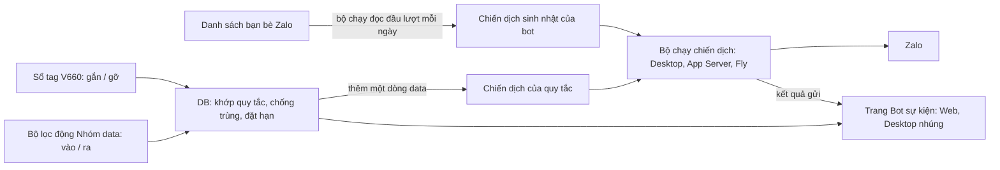

# Bot sự kiện cho akaAgent (Web + Desktop)

> **Trạng thái:** phương án bản 2, ngày 26/11/2026. Chưa code, chưa có migration.
> Bản 1 phủ sáu sự kiện của akaChat. Anh chốt: **tập trung ba sự kiện: Sinh nhật, Thêm/gỡ tag Zalo, Vào/ra nhóm điều
> kiện.** Bản này viết lại theo phạm vi đó, và đổi đề xuất kiến trúc (mục 3) vì ba sự kiện này không cần bộ nghe tin
> nhắn.
> Số liệu lấy bằng truy vấn chỉ đọc trên `akachat` ngày 26/11/2026 (chỉ đếm, đọc cấu trúc bảng và mã hàm SQL).
> Tính năng gốc: akaAgentChatApi `docs/ZALO_EVENT_CHATBOT.md`; giao diện gốc: akaAgentChatWeb `app/settings/chatbot/`.
> Các câu cần anh chốt ở mục 12, mỗi câu có đề xuất sẵn.

## 1. Mục tiêu và phạm vi

Khách akaAgent cài cho từng tài khoản Zalo một bot tự gửi tin soạn sẵn khi có một trong ba sự kiện:

| Sự kiện | Khi | Thì |
|---|---|---|
| **Sinh nhật** | Hôm nay là sinh nhật của một người bạn Zalo | Gửi tin chúc mừng |
| **Thêm/gỡ tag Zalo** | Một tag Zalo đã chọn được gắn vào, hoặc bị gỡ khỏi một người | Gửi tin |
| **Vào/ra nhóm điều kiện** | Một người bắt đầu thoả, hoặc hết thoả, bộ điều kiện của nhóm | Gửi tin lúc vào và / hoặc lúc ra |

Trang cài đặt có trên Web và trong app Desktop, bố cục như trang "Chatbot sự kiện" của akaChat (ảnh anh gửi): cột
tài khoản bên trái, dải trạng thái + "Nhật ký và báo cáo" + "Dừng bot ngay", tab "Sự kiện" và "Loại trừ", công tắc
chung, khối quy tắc luôn áp dụng, mỗi sự kiện một thẻ có công tắc riêng.

Không làm trong phương án này: Hội thoại mới, Tin nhắn theo khung giờ và nhãn, Thêm/gỡ nhãn hệ thống. Ba sự kiện đó
cần bộ nghe tin nhắn và lệnh đồng ý kết bạn (phân tích ở bản 1, còn trong lịch sử git của file này).

## 2. Khảo sát

### 2.1. Vì sao không bê nguyên bot akaChat

Bot akaChat (vòng `chatbot_event` trong worker của ChatApi) tìm sự kiện bằng dữ liệu Chat đã lưu trong DB, nên chỉ
chạy cho tài khoản Zalo Server có binding Chat. Tài khoản Zalo đang đăng nhập của akaAgent:

| Loại tài khoản | Nơi chạy | Đang đăng nhập | Có dữ liệu Chat |
|---|---|---|---|
| Zalo Server, tổ chức có akaChat | Fly | 147 | Có |
| Zalo Server, tổ chức không akaChat | Fly | 273 | Không |
| Zalo Server | App Server (VPS) | 1.321 | Không |
| Zalo QR | Desktop | 874 | Không |
| Zalo trình duyệt | Desktop | 390 | Không |

Bot akaChat phủ 147 trên 3.005 tài khoản. Nó cũng chưa chạy thật: `zalo.chatbot_event.enabled` đang `false`, mới 1
tài khoản cài, 0 việc đã tạo.

### 2.2. Ba sự kiện anh chọn: akaAgent đã có sẵn phần phát hiện

| Sự kiện | Phần đã có trong akaAgent | Tình trạng |
|---|---|---|
| Sinh nhật | Chiến dịch `zalo_message_birthday`: đầu lượt đọc danh sách bạn bè, lấy người có ngày sinh trùng hôm nay, đánh dấu ngày đã lấy (`packages/campaign-engine/src/zalo/materialize.ts:391`, bộ cũ `campaignScheduler.ts:10621`) | Đang có trên mọi bản app |
| Thêm/gỡ tag Zalo | Sổ tag V660: nơi chạy hỏi `getLabels` 60 giây một lần, DB so với `auto_zalo_tag_members` và ghi **cả gắn lẫn gỡ** vào `auto_zalo_tag_member_events`; lần đầu và sau khi mất kết nối quá 30 phút chỉ lấy mốc | V660 đã apply, `zalo.tag_sync.enabled` = `true`; mã Desktop, App Server, ChatApi đã merge, **chưa bản nào phát hành hay deploy**, sổ đang 0 dòng |
| Vào/ra nhóm điều kiện | Nhóm data có "Bộ lọc động" (V250–V253): hai khối điều kiện vào / ra, đúng công thức akaChat mượn (ở trong nhóm khi khớp khối vào VÀ không khớp khối ra); job pg_cron `aka-agent-data-group-dynamic-filter-worker` 30 giây một lần; nhật ký vào / rời nhóm `auto_data_group_member_events` (V458) | Đang chạy: 10 bộ lọc ở 3 tổ chức, 1.536 lượt vào nhóm trong 30 ngày. Web đã có form điều kiện `DataGroupDynamicFilterPanel.tsx` |

Chi tiết quan trọng đọc được từ mã hàm trên production:

- Sổ tag chỉ theo dõi tài khoản đang có chiến dịch "tự gửi cho người được gắn tag"
  (`private.aka_agent_zalo_tag_sync_watched`), và loại Zalo trình duyệt. Danh sách tài khoản cần hỏi tag do **DB trả
  về**, nên thêm tài khoản bật bot vào danh sách chỉ cần sửa hàm DB, không cần sửa app.
- Bộ lọc động có bốn trường: Tag Zalo, Tag akaBiz, Trạng thái kết bạn Zalo, Trạng thái thành viên group Zalo. Không
  có ba trường "tin gần nhất" của akaChat (akaAgent không lưu hội thoại).
- Bộ lọc động chỉ xét **liên hệ Zalo cá nhân đã có trong DB** (`auto_account_contacts`). Trường Tag Zalo đọc tag
  từ dữ liệu Chat (tổ chức có akaChat) hoặc từ lần quét danh bạ gần nhất; nó **chưa đọc sổ tag V660**, nên với tài
  khoản không akaChat tag có thể cũ.
- Quy trình tự động đã có trigger "khách vào Nhóm data" (22 nguồn đã tạo), chưa có trigger "ra nhóm".
- Ngày sinh trong bảng `zalo_users` không dùng được để tự tính sinh nhật trong DB: mẫu 1% cho thấy chỉ một nửa bạn
  bè có ngày sinh và 14% được cập nhật trong 7 ngày. Phải đọc danh sách bạn bè trực tiếp như chiến dịch đang làm.

## 3. Kiến trúc: đổi đề xuất so với bản 1

Bản 1 đề xuất một bộ máy gửi riêng cho bot, vì "Hội thoại mới" và "Tin nhắn theo khung giờ" cần đồng ý kết bạn, cần
trả lời trong một hai phút, và cần biết nhân viên đã nhắn hay chưa. Ba sự kiện anh chọn không cần cả ba điều đó, nên
hai cách gửi cân lại như sau:

| | B. Gửi bằng chiến dịch do bot quản lý (đề xuất) | C. Bộ máy gửi riêng của bot |
|---|---|---|
| Cách làm | Bot tạo sẵn một chiến dịch `[Bot sự kiện] …` cho mỗi quy tắc. Có sự kiện thì DB thêm người đó vào chiến dịch; bộ chạy chiến dịch gửi | Bảng việc riêng, RPC nhận bước và báo kết quả riêng, mã chạy bước mới ở Desktop, App Server, Fly |
| Mã gửi mới | Không có | Có, ở ba nơi chạy; phải phát hành Desktop, cài App Server, deploy ChatApi |
| Hạn mức, khoá, chính sách lỗi, loại trừ gửi | Dùng chung với chiến dịch: tin của bot được đếm vào hạn mức ngày / giờ của tài khoản | Riêng của bot, chỉ đọc khoá của chiến dịch; tin của bot cộng thêm ngoài hạn mức |
| Thời điểm gửi | Xếp hàng với chiến dịch khác của tài khoản. Tài khoản đang chạy sát hạn mức thì tin của bot phải chờ | Gửi trong một hai phút |
| Lịch sử | Có sẵn: Lịch sử hành động, Kết quả chạy, Báo cáo của chiến dịch | Phải làm nhật ký riêng |
| Tiền lệ trong akaAgent | Quy trình tự động (`[Quy trình] …`), tự gửi theo tag V660, group thời gian thực | Chưa có |
| Đụng hệ đang chạy | Không sửa hàm engine. Thêm chỗ móc vào hàm sổ tag và hàm lọc động | Không sửa hàm engine |

**Đề xuất B.** Lý do: không phải viết mã gửi mới ở ba nơi chạy, nên hai trên ba sự kiện chạy được ngay trên các bản
app khách đang dùng; và tin của bot nằm trong hạn mức của tài khoản. Điểm thứ hai quan trọng với akaAgent: tài khoản
ở đây chạy chiến dịch sát giới hạn của Zalo, một chiến dịch gắn tag cho vài trăm người rồi bot gửi thêm ngần ấy tin
ngoài hạn mức là đường dẫn tới khoá tài khoản.

Cái giá của B: tin của bot không đi ngay khi tài khoản đang bận chiến dịch khác hoặc đã hết hạn mức giờ. Bộ lập lịch
xếp chiến dịch chờ theo giờ hẹn (`campaignRepository.ts:3608`), bot không được ưu tiên. Mục 7 đặt hạn cho từng tin để
tin quá cũ không bị gửi muộn.

## 4. Ba sự kiện

### 4.1. Sinh nhật

- **Cài:** một quy tắc mỗi tài khoản: nội dung tin, giờ gửi trong ngày (mặc định 08:30).
- **Cách chạy:** thẻ Sinh nhật tạo và giữ một chiến dịch `zalo_message_birthday` lịch hằng ngày, tên
  `[Bot sự kiện] Sinh nhật · <tài khoản>`. Sửa thẻ là sửa chiến dịch đó; tắt thẻ là tạm dừng nó.
- **Ai nhận:** bạn bè Zalo có sinh nhật hôm nay. Zalo chỉ cho biết ngày sinh của bạn bè.
- **Mỗi người một lần mỗi năm:** chiến dịch đánh dấu ngày đã lấy danh sách, mỗi ngày lấy một lần.
- **App Desktop tắt lúc tới giờ (Zalo QR):** mở app trong ngày thì gửi lúc mở. Qua ngày thì không gửi bù.
- **Khác akaChat:** akaChat chờ thông báo sinh nhật của Zalo gửi vào hội thoại; akaAgent đọc danh sách bạn bè, không
  phụ thuộc thông báo đó.
- **Trùng:** tài khoản đã có chiến dịch sinh nhật khác đang chạy thì khách nhận hai lời chúc. Thẻ cảnh báo và nêu tên
  chiến dịch đó.
- **Việc phải làm:** không có ở bộ chạy. Chỉ có phần trang và hàm lưu (mục 6).

### 4.2. Thêm/gỡ tag Zalo

- **Cài:** nhiều quy tắc mỗi tài khoản. Mỗi quy tắc: chiều (được gắn / bị gỡ), một hay nhiều tag, nội dung tin,
  khoảng cách tối thiểu giữa hai lần gửi cho cùng một người (mặc định 12 giờ).
- **Phát hiện:** sổ tag V660. Bot thêm tài khoản có quy tắc tag đang bật vào danh sách tài khoản cần hỏi tag; phần
  hỏi `getLabels`, so sánh, ghi gắn / gỡ đã có sẵn.
- **Khớp:** mỗi dòng gắn / gỡ mới của sổ tag được so với quy tắc của tài khoản. Nhiều quy tắc cùng khớp thì chỉ chạy
  quy tắc đứng đầu (như akaChat). Khớp thì thêm người đó vào chiến dịch của quy tắc.
- **Không gửi khi:**
  - bật quy tắc lần đầu, hoặc đổi tag của quy tắc: người đang có tag sẵn không nhận tin (sổ tag chỉ lấy mốc);
  - tài khoản mất kết nối quá 30 phút rồi nối lại: lần so đầu chỉ lấy mốc (đã có trong V660);
  - tag bị xoá hẳn trên Zalo (mọi người "bị gỡ" cùng lúc);
  - đối tượng gắn tag là nhóm Zalo;
  - người đó vừa nhận tin của chính quy tắc này trong khoảng cách tối thiểu.
- **Độ trễ:** Desktop và App Server hỏi tag 60 giây một lần, nên tag gắn trên điện thoại được thấy sau một hai phút.
  akaChat chỉ thấy khi runtime đồng bộ nhãn, có thể sau nhiều giờ.
- **Phụ thuộc:** chỉ chạy ở nơi đã có mã sổ tag: bản Desktop và App Server build sau PR #812, và ChatApi sau khi
  deploy phần `tag_sync`. Zalo trình duyệt chưa có (sổ tag đang loại loại tài khoản này).
- **Liên quan tới "tự gửi cho người được gắn tag" (V660):** hai tính năng dùng chung sổ tag và chạy độc lập. Cùng một
  tag vừa có quy tắc "được gắn" của bot vừa có chiến dịch tự thêm thì khách nhận hai tin; thẻ cảnh báo trường hợp này.
- **Việc phải làm:** sửa hàm `aka_agent_zalo_tag_sync_watched` (thêm tài khoản của bot); chỗ móc sau khi sổ tag ghi
  gắn / gỡ; nhận ra tag bị xoá hẳn.

### 4.3. Vào/ra nhóm điều kiện

- **Cài:** nhiều nhóm mỗi tài khoản. Mỗi nhóm là một Nhóm data loại Zalo cá nhân có Bộ lọc động: chọn nhóm có sẵn,
  hoặc tạo mới ngay trong thẻ bằng form điều kiện hiện có. Hai tin tuỳ chọn: gửi khi vào nhóm, gửi khi ra nhóm; ít
  nhất một tin bật.
- **Điều kiện:** Tag Zalo, Tag akaBiz, Trạng thái kết bạn, Thành viên group Zalo (trường cuối akaChat không có).
  Công thức như akaChat: ở trong nhóm khi khớp khối vào và không khớp khối ra; khối ra trống nghĩa là ra khi hết
  khớp khối vào.
- **Phát hiện:** job lọc động 30 giây đang chạy. Bot móc vào đúng hai chỗ hàm lọc ghi nhận một người vào và ra.
- **Khớp:** người vừa vào (hoặc ra) nhóm mà liên hệ thuộc tài khoản đang cài bot thì được thêm vào chiến dịch "khi
  vào" (hoặc "khi ra") của nhóm đó. Các nhóm độc lập: một người vào hai nhóm thì nhận tin của cả hai (như akaChat).
- **Không gửi khi:** bật nhóm lần đầu hoặc đổi điều kiện (bộ lọc động vốn chỉ tính thay đổi sau lúc lưu); người vào
  nhóm do thêm tay hay nhập file (đợt 1 chỉ tính vào / ra do điều kiện, xem câu 7 mục 12).
- **Khác akaChat:**
  - chỉ xét người **đã có trong danh bạ của tài khoản trên hệ thống** (đã quét bạn bè, thành viên group, hoặc nhập
    data); akaChat xét mọi hội thoại;
  - không có điều kiện theo "tin gần nhất".
- **Việc phải làm:**
  - chỗ móc vào / ra trong `aka_agent_process_data_group_dynamic_filters_core`;
  - cho trường Tag Zalo đọc thêm sổ tag V660 và cho sổ tag đẩy người vừa đổi tag vào hàng chờ lọc, để tài khoản
    không akaChat có tag tươi. Thiếu việc này, điều kiện theo tag chỉ đổi khi khách quét lại danh bạ;
  - tạo liên hệ cho người có trong sổ tag mà chưa có trong danh bạ.
- **Trùng:** nhóm đang là nguồn của một Quy trình tự động đang chạy thì khách có thể nhận tin của cả quy trình lẫn
  bot. Thẻ cảnh báo và nêu tên quy trình.

## 5. Dữ liệu (chỉ thêm bảng; hai hàm có sẵn được thêm chỗ móc)

| Bảng | Nội dung |
|---|---|
| `auto_event_bot_settings` | Mỗi tài khoản một dòng: công tắc chung, công tắc từng sự kiện, lựa chọn loại trừ, `revision`, người sửa, giờ sửa |
| `auto_event_bot_rules` | Quy tắc: loại sự kiện, tên, bật / tắt, thứ tự, `revision`, điều kiện và nội dung dạng JSON cùng khuôn với akaChat (`ChatbotEventRuleStored`), khoảng cách tối thiểu, mã Nhóm data (nhóm điều kiện), mã chiến dịch bot đã tạo cho quy tắc |
| `auto_event_bot_jobs` | Mỗi lần sự kiện khớp quy tắc một dòng, **kể cả lần bot không gửi**: quy tắc, người nhận, sự kiện gốc, chiều, khoá chống trùng, mã dòng data đã thêm vào chiến dịch, hạn, kết quả, lý do không gửi. Nguồn của "Nhật ký và báo cáo" |

- Chiến dịch của bot dùng loại `zalo_message_group_member` (gửi theo UID, loại Quy trình tự động đang dùng) cho tag
  và nhóm điều kiện; `zalo_message_birthday` cho sinh nhật. Thêm người vào chiến dịch bằng đúng cách Quy trình tự
  động đang làm: khoá chống trùng `control_append_idempotency_key = 'evbot:<việc>'`, chiến dịch "hoàn thành" thì mở
  lại. Không sửa cấu trúc bảng chiến dịch, bảng data.
- RLS bật, thu hồi quyền bảng. Trang đọc và ghi qua một RPC `aka_agent_control_event_bot(staff, org, action,
  payload)` chỉ `service_role` (API Web gọi), lưu có kiểm `revision`.
- Hàm sổ tag và hàm lọc động được thêm chỗ móc bằng bộ sinh có kiểm md5 thân hàm trước và sau, như các migration
  sửa hàm khác. Bot tắt hoặc tài khoản không cài bot thì chỗ móc thoát ngay.
- Job pg_cron mỗi phút: đóng dòng data của bot đã quá hạn mà chưa gửi (mục 7), đọc kết quả gửi về bảng việc, dọn
  việc cũ hơn 90 ngày.
- Công tắc `auto_system_settings` `event_bot`: `{"audience":"off|admin_akabiz|orgs|all","organizationIds":[]}`,
  migration đặt `off`.
- Hợp đồng dùng chung `eventBot.ts` đặt ở WebApp `packages/control-api`. Hàm kiểm quy tắc và khuôn báo cáo chép từ
  ChatApi `packages/chat-domain/src/chatbotEvent.ts`, `chatbotEventReport.ts`.

## 6. Giao diện

### 6.1. Web

- Trang mới **"Bot sự kiện"**, đường dẫn `/automation/event-bot`, mục menu riêng dưới "Tự động hóa"
  (`apps/web/src/components/AppShell.tsx`), ẩn với tổ chức chỉ có Facebook. Đặt dưới `/automation/` vì khung nhúng
  của Desktop đã cho đi mọi đường `/automation/*`.
- Bố cục theo ảnh anh gửi:
  1. Cột trái: tài khoản Zalo của nhân viên, ô tìm, trạng thái (Đang bật, Đang tắt, Cài ở akaChat).
  2. Dải trạng thái của tài khoản đang chọn: bot có đang chạy không và vì sao (tài khoản chưa đăng nhập, app Desktop
     đang tắt, app chưa có phần hỏi tag, tài khoản đang hết hạn mức tới giờ nào, tính năng chưa mở); nút "Nhật ký và
     báo cáo", "Dừng bot ngay".
  3. Tab "Sự kiện": công tắc chung, khối quy tắc luôn áp dụng (mục 7), ba thẻ Sinh nhật, Thêm/gỡ tag Zalo, Vào/ra
     nhóm điều kiện. Thẻ nhóm điều kiện dùng lại `DataGroupDynamicFilterPanel.tsx`, hiện số người đang trong nhóm, số
     vào / ra 24 giờ qua, số tin đã gửi 7 ngày.
  4. Tab "Loại trừ": thẻ "Không gửi cho" của chiến dịch (nhóm loại trừ, danh sách không gửi), áp cho mọi chiến dịch
     của bot trên tài khoản đó.
  5. Thanh lưu: "Đang bật N sự kiện cho <tài khoản>. Sửa lần cuối lúc …", Bỏ thay đổi, Lưu thay đổi.
- Ô soạn tin: chỉ văn bản, biến và spin như chiến dịch, dùng `ContentVariants` của form Quy trình và bộ kiểm
  `contentSyntax.ts`.
- "Nhật ký và báo cáo": theo tài khoản, tối đa 90 ngày; số lần khớp, đã gửi, chưa gửi, không gửi kèm lý do; danh
  sách từng lần, bấm vào xem dòng lịch sử của chiến dịch.
- Lần đầu bật có hộp xác nhận: bot không có chạy thử, có sự kiện khớp là gửi thật.
- Chiến dịch `[Bot sự kiện] …` hiện trong danh sách chiến dịch như chiến dịch `[Quy trình] …`; nội dung và lịch sửa
  ở trang bot.

### 6.2. Desktop

- Mục menu "Bot sự kiện" (khi có gói Zalo) mở trang Web trong khung nhúng `?embed=desktop`, chung phiên với thẻ Quy
  trình. Việc phải làm: tách `JourneyWebService` (`src/main/services/journeyWebService.ts`, đang viết cứng đường
  `/automation` và chữ "Tự động hóa") thành dịch vụ nhúng nhận đường mặc định và tiêu đề; thêm trang vào `TopBar.tsx`,
  `App.tsx`.
- Desktop không cần mã chạy mới cho bot. Bản Desktop cũ không có mục menu thì khách cài trên Web; sinh nhật và nhóm
  điều kiện vẫn chạy trên bản cũ.

### 6.3. iOS

Để sau. API dùng chung nên chỉ thêm màn hình.

## 7. Quy tắc luôn áp dụng

| Quy tắc | Cách thực hiện |
|---|---|
| Chỉ gửi cho cá nhân | Nhóm Zalo gắn tag bị bỏ; nhóm điều kiện chỉ có liên hệ cá nhân |
| Bỏ qua người bị loại trừ | Thẻ "Không gửi cho" của chiến dịch, kiểm lúc nhận data và trước khi gửi |
| Bật bot không gửi cho người cũ | Sổ tag lấy mốc; bộ lọc động chỉ tính thay đổi sau lúc lưu |
| Không gửi tin quá cũ | Mỗi dòng bot thêm vào chiến dịch có hạn: tag và nhóm điều kiện 6 giờ, sinh nhật hết ngày. Quá hạn mà chưa gửi thì dòng bị đóng "Quá hạn, không gửi" |
| Chung hạn mức và khoá với chiến dịch | Tin của bot do bộ chạy chiến dịch gửi, đếm vào hạn mức ngày / giờ, dừng khi thao tác bị khoá |
| Một người không nhận dồn | Khoảng cách tối thiểu của quy tắc; chống trùng theo khoá của từng sự kiện |

Khác akaChat: **không có** quy tắc "nhân viên đã nhắn thì bot dừng". Quy tắc đó cần bộ nghe tin nhắn để biết nhân
viên vừa nhắn; ba sự kiện này không dùng bộ nghe. Khối quy tắc trên trang không ghi dòng đó.

## 8. Tài khoản nào dùng được

| Loại tài khoản | Sinh nhật | Thêm/gỡ tag Zalo | Vào/ra nhóm điều kiện |
|---|---|---|---|
| Zalo QR (Desktop) | Có, khi app mở | Có, cần bản Desktop có sổ tag | Có |
| Zalo Server trên VPS | Có | Có, cần App Server có sổ tag | Có |
| Zalo Server trên Fly | Có | Có, cần deploy ChatApi phần `tag_sync` | Có |
| Zalo trình duyệt | Cần kiểm chiến dịch sinh nhật trên loại này | Chưa | Có; điều kiện theo tag chỉ đổi khi quét lại danh bạ |
| Tài khoản tổ chức có akaChat | Câu 3 mục 12 | | |

## 9. Tài nguyên

- Không thêm request từ app: bot không có mã chạy trên Desktop hay App Server.
- Thêm tài khoản vào danh sách hỏi tag: mỗi tài khoản một lượt gọi Zalo mỗi phút, DB chỉ nhận dữ liệu khi tag đổi
  (như V660).
- Chỗ móc trong hàm sổ tag và hàm lọc động: một lượt tra theo tài khoản cho mỗi lần có người đổi tag hoặc vào / ra
  nhóm; không có quy tắc thì không tra.
- Job mỗi phút chỉ đọc dòng việc đang mở của bot theo chỉ mục riêng.
- Số chiến dịch tăng: mỗi quy tắc một chiến dịch (nhóm điều kiện tối đa hai). Đề xuất trần 10 quy tắc tag và 10 nhóm
  điều kiện mỗi tài khoản.

## 10. Việc phải làm và các đợt

| Repo | Việc |
|---|---|
| akaAgent (DB) | Migration: ba bảng, RPC trang, chỗ móc sổ tag và lọc động, mở rộng danh sách hỏi tag, nối sổ tag vào điều kiện Tag Zalo, job hết hạn và dọn, công tắc; bản gỡ; bộ sinh SQL; bài kiểm PG17 |
| akaAgentWebApp | Hợp đồng `eventBot.ts`; route API `/event-bot/*`; trang, hai tab, ba thẻ, nhật ký và báo cáo; tạo và sửa chiến dịch của bot; mục menu; chế độ nhúng |
| akaAgent (Desktop) | Dịch vụ nhúng dùng chung, mục menu, trang |
| akaAgentChatApi, akaAgentChatWeb | Không đổi. Sự kiện tag trên Fly cần deploy phần `tag_sync` đã merge |

| Đợt | Nội dung |
|---|---|
| 0 | Anh chốt mục 12; em làm bản thiết kế giao diện để anh duyệt |
| 1 | DB + API + trang Web với cả ba sự kiện; nhật ký và báo cáo. Sinh nhật và nhóm điều kiện chạy ngay trên các bản app hiện có; tag chạy ở nơi đã có sổ tag |
| 2 | Mục menu và khung nhúng trên Desktop (đi cùng bản Desktop kế tiếp, bản này cũng mang sổ tag) |
| 3 | iOS; sổ tag cho Zalo trình duyệt nếu đọc tag được trên loại này |

## 11. Kiểm thử, triển khai, rủi ro

**Kiểm thử**

- SQL (PG17 cục bộ, nạp thân hàm production của sổ tag và lọc động): từng sự kiện, chống trùng, khoảng cách tối
  thiểu, lấy mốc lúc bật, tag bị xoá hẳn, hết hạn, hai lượt chạy đồng thời, bản gỡ; so kết quả hai hàm được móc với
  bản trước khi không có quy tắc bot nào (phải giống hệt).
- Mô phỏng trọn đường: sổ tag giả phát chuỗi gắn / gỡ, bộ lọc động thật, bộ chạy engine v2 thật với Zalo giả; bất
  biến: không ai nhận hai tin cho một sự kiện, không gửi cho người bị loại trừ, không gửi dòng quá hạn, không gửi cho
  người có tag từ trước khi bật.
- Phát lại dữ liệu thật (chỉ đọc): 1.536 lượt vào nhóm 30 ngày qua của ba tổ chức đang dùng bộ lọc động, xem bot sẽ
  tạo bao nhiêu việc.
- Giao diện: bài kiểm trang với API giả; khung nhúng trên Electron.
- Thử thật: tài khoản thử của tổ chức 1 trên Zalo QR, Zalo Server VPS, Fly.

**Triển khai:** apply migration (công tắc tắt) → deploy API và Web → mở `event_bot` cho admin akaBiz → vài tổ chức →
mọi khách. Desktop theo bản phát hành kế.

**Gỡ theo mức:** tắt một sự kiện → "Dừng bot ngay" (tạm dừng mọi chiến dịch của bot trên tài khoản, đóng dòng đang
chờ) → `event_bot` về `off` (chỗ móc thoát ngay) → bản gỡ migration.

| Rủi ro | Cách xử lý |
|---|---|
| Tin của bot tới muộn vì tài khoản bận hoặc hết hạn mức | Hạn 6 giờ; dải trạng thái báo tài khoản đang hết hạn mức; nhật ký ghi rõ "quá hạn" |
| Chiến dịch gắn tag hàng loạt làm bot gửi hàng loạt | Tin của bot nằm trong hạn mức của tài khoản nên không vượt giới hạn Zalo; phần không kịp gửi trong hạn thì bỏ |
| Trùng với chiến dịch sinh nhật, chiến dịch tự thêm theo tag, Quy trình tự động | Cảnh báo trên từng thẻ, nêu tên chiến dịch hoặc quy trình trùng |
| Điều kiện theo tag của nhóm điều kiện bị cũ | Nối sổ tag V660 vào bộ lọc động (mục 4.3) |
| Sửa hàm sổ tag và hàm lọc động đang chạy | Bộ sinh kiểm md5; chỗ móc thoát ngay khi không có quy tắc; bài kiểm so kết quả trước và sau |
| Khách sửa hoặc xoá chiến dịch `[Bot sự kiện]` từ danh sách chiến dịch | Trang bot phát hiện chiến dịch bị xoá hoặc tạm dừng tay và báo ở dải trạng thái; lưu lại thì tạo lại |
| Sự kiện tag chưa chạy vì app chưa có sổ tag | Dải trạng thái nói rõ tài khoản cần bản app nào |

## 12. Cần anh chốt

| # | Câu hỏi | Đề xuất |
|---|---|---|
| 1 | Cách gửi | **B**: gửi bằng chiến dịch do bot quản lý, chung hạn mức với chiến dịch (mục 3). Chọn C nếu anh muốn tin của bot đi ngay và không tính vào hạn mức |
| 2 | Vị trí trang | Mục menu riêng "Bot sự kiện" dưới "Tự động hóa" trên Web và Desktop; Desktop nhúng trang Web |
| 3 | Tổ chức có akaChat | Tài khoản đã có trong akaChat dùng bot của akaChat; trang akaAgent hiện "Cài ở akaChat" kèm link, để khách không nhận hai tin |
| 4 | Sinh nhật | Theo danh sách bạn bè có sinh nhật hôm nay, giờ gửi mặc định 08:30, không gửi bù khi qua ngày |
| 5 | Hạn của tin | Tag và nhóm điều kiện: quá 6 giờ chưa gửi thì bỏ |
| 6 | Nhiều quy tắc tag cùng khớp | Chỉ chạy quy tắc đứng đầu (như akaChat) |
| 7 | Nhóm điều kiện: tính vào / ra nào | Chỉ vào / ra do điều kiện. Người được thêm tay hoặc nhập file vào nhóm không nhận tin |
| 8 | Nhóm điều kiện: nhóm nào | Chọn Nhóm data có sẵn có Bộ lọc động, hoặc tạo mới trong thẻ; nhóm tạo từ thẻ cũng hiện ở trang Nhóm data |
| 9 | "Nhân viên đã nhắn thì bot dừng" | Không có trong ba sự kiện này (mục 7) |
| 10 | Chiến dịch của bot | Hiện trong danh sách chiến dịch với tiền tố `[Bot sự kiện]`, như `[Quy trình]` |
| 11 | Quyền | Nhân viên cài bot cho tài khoản Zalo của chính mình |
| 12 | Đối tượng | Mọi khách có gói Zalo; mở dần bằng công tắc `event_bot` |

Chưa xác minh, sẽ kiểm ở bước thiết kế kỹ thuật: chiến dịch sinh nhật có chạy trên Zalo trình duyệt không; Zalo
trình duyệt có đọc được danh sách tag không; chiến dịch sinh nhật xử lý thế nào với dòng của hôm trước chưa gửi
(để chắc không gửi bù qua ngày); hàm thêm người vào chiến dịch của Quy trình tự động tách ra dùng chung được tới đâu.
