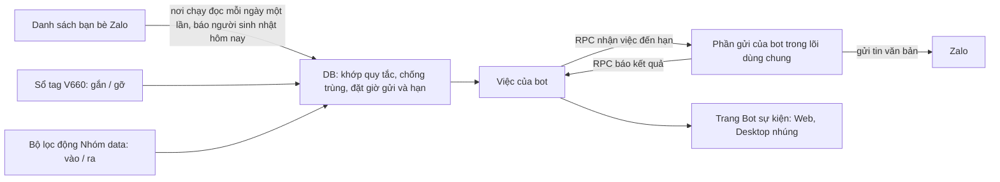

# Bot sự kiện cho akaAgent (Web + Desktop)

> **Trạng thái:** phương án bản 3, ngày 26/11/2026. Chưa code, chưa có migration.
> Anh đã chốt hai điều:
> 1. **Tập trung ba sự kiện:** Sinh nhật, Thêm/gỡ tag Zalo, Vào/ra nhóm điều kiện.
> 2. **Bot gửi độc lập:** "hoạt động gửi tin của bot không bị ràng buộc bởi giới hạn của tài khoản hay hành động,
>    không tác động đến bộ đếm hay chiến dịch chạy, nó độc lập". Bản 2 đề xuất gửi bằng chiến dịch do bot quản lý
>    (chung hạn mức); bản này bỏ cách đó và dùng bộ máy gửi riêng của bot (mục 3).
> Số liệu lấy bằng truy vấn chỉ đọc trên `akachat` ngày 26/11/2026 (chỉ đếm, đọc cấu trúc bảng và mã hàm SQL).
> Tính năng gốc: akaAgentChatApi `docs/ZALO_EVENT_CHATBOT.md`; giao diện gốc: akaAgentChatWeb `app/settings/chatbot/`.
> Các câu còn cần anh chốt ở mục 12, mỗi câu có đề xuất sẵn.
> Bản thiết kế giao diện (26/11/2026, chưa duyệt, dựng theo các đề xuất của mục 12):
> https://claude.ai/artifact/4UQDyJzycDXBqeFpVLhGJ2

## 1. Mục tiêu và phạm vi

Khách akaAgent cài cho từng tài khoản Zalo một bot tự gửi tin soạn sẵn khi có một trong ba sự kiện:

| Sự kiện | Khi | Thì |
|---|---|---|
| **Sinh nhật** | Hôm nay là sinh nhật của một người bạn Zalo | Gửi tin chúc mừng |
| **Thêm/gỡ tag Zalo** | Một tag Zalo đã chọn được gắn vào, hoặc bị gỡ khỏi một người | Gửi tin |
| **Vào/ra nhóm điều kiện** | Một người bắt đầu thoả, hoặc hết thoả, bộ điều kiện của nhóm | Gửi tin lúc vào và / hoặc lúc ra |

Trang cài đặt có trên Web và trong app Desktop, bố cục như trang "Chatbot sự kiện" của akaChat (ảnh anh gửi): cột
tài khoản bên trái, dải trạng thái + "Nhật ký và báo cáo" + "Dừng bot ngay", tab "Sự kiện" và "Loại trừ", công tắc
chung, khối quy tắc luôn áp dụng, mỗi sự kiện một thẻ có công tắc riêng.

Không làm trong phương án này: Hội thoại mới, Tin nhắn theo khung giờ và nhãn, Thêm/gỡ nhãn hệ thống. Ba sự kiện đó
cần bộ nghe tin nhắn và lệnh đồng ý kết bạn (phân tích ở bản 1, còn trong lịch sử git của file này).

## 2. Khảo sát

### 2.1. Vì sao không bê nguyên bot akaChat

Bot akaChat (vòng `chatbot_event` trong worker của ChatApi) tìm sự kiện bằng dữ liệu Chat đã lưu trong DB, nên chỉ
chạy cho tài khoản Zalo Server có binding Chat. Tài khoản Zalo đang đăng nhập của akaAgent:

| Loại tài khoản | Nơi chạy | Đang đăng nhập | Có dữ liệu Chat |
|---|---|---|---|
| Zalo Server, tổ chức có akaChat | Fly | 147 | Có |
| Zalo Server, tổ chức không akaChat | Fly | 273 | Không |
| Zalo Server | App Server (VPS) | 1.321 | Không |
| Zalo QR | Desktop | 874 | Không |
| Zalo trình duyệt | Desktop | 390 | Không |

Bot akaChat phủ 147 trên 3.005 tài khoản. Nó cũng chưa chạy thật: `zalo.chatbot_event.enabled` đang `false`, mới 1
tài khoản cài, 0 việc đã tạo.

### 2.2. Ba sự kiện anh chọn: akaAgent đã có sẵn phần phát hiện

| Sự kiện | Phần đã có trong akaAgent | Tình trạng |
|---|---|---|
| Sinh nhật | Chiến dịch `zalo_message_birthday`: đầu lượt đọc danh sách bạn bè, lấy người có ngày sinh trùng hôm nay, đánh dấu ngày đã lấy (`packages/campaign-engine/src/zalo/materialize.ts:391`, bộ cũ `campaignScheduler.ts:10621`) | Đang có trên mọi bản app |
| Thêm/gỡ tag Zalo | Sổ tag V660: nơi chạy hỏi `getLabels` 60 giây một lần, DB so với `auto_zalo_tag_members` và ghi **cả gắn lẫn gỡ** vào `auto_zalo_tag_member_events`; lần đầu và sau khi mất kết nối quá 30 phút chỉ lấy mốc | V660 đã apply, `zalo.tag_sync.enabled` = `true`; mã Desktop, App Server, ChatApi đã merge, **chưa bản nào phát hành hay deploy**, sổ đang 0 dòng |
| Vào/ra nhóm điều kiện | Nhóm data có "Bộ lọc động" (V250–V253): hai khối điều kiện vào / ra, đúng công thức akaChat mượn (ở trong nhóm khi khớp khối vào VÀ không khớp khối ra); job pg_cron `aka-agent-data-group-dynamic-filter-worker` 30 giây một lần; nhật ký vào / rời nhóm `auto_data_group_member_events` (V458) | Đang chạy: 10 bộ lọc ở 3 tổ chức, 1.536 lượt vào nhóm trong 30 ngày. Web đã có form điều kiện `DataGroupDynamicFilterPanel.tsx` |

Chi tiết quan trọng đọc được từ mã hàm trên production:

- Sổ tag chỉ theo dõi tài khoản đang có chiến dịch "tự gửi cho người được gắn tag"
  (`private.aka_agent_zalo_tag_sync_watched`), và loại Zalo trình duyệt. Danh sách tài khoản cần hỏi tag do **DB trả
  về**, nên thêm tài khoản bật bot vào danh sách chỉ cần sửa hàm DB, không cần sửa app.
- Bộ lọc động có bốn trường: Tag Zalo, Tag akaBiz, Trạng thái kết bạn Zalo, Trạng thái thành viên group Zalo. Không
  có ba trường "tin gần nhất" của akaChat (akaAgent không lưu hội thoại).
- Bộ lọc động chỉ xét **liên hệ Zalo cá nhân đã có trong DB** (`auto_account_contacts`). Trường Tag Zalo đọc tag
  từ dữ liệu Chat (tổ chức có akaChat) hoặc từ lần quét danh bạ gần nhất; nó **chưa đọc sổ tag V660**, nên với tài
  khoản không akaChat tag có thể cũ.
- Quy trình tự động đã có trigger "khách vào Nhóm data" (22 nguồn đã tạo), chưa có trigger "ra nhóm".
- Ngày sinh trong bảng `zalo_users` không dùng được để tự tính sinh nhật trong DB: mẫu 1% cho thấy chỉ một nửa bạn
  bè có ngày sinh và 14% được cập nhật trong 7 ngày. Phải đọc danh sách bạn bè trực tiếp như chiến dịch đang làm.

## 3. Kiến trúc: bộ máy gửi riêng của bot

Theo điều anh chốt, bot có đường gửi riêng, tách hẳn khỏi hệ chiến dịch:

| Bot **không** làm | Nghĩa là |
|---|---|
| Không tính hạn mức | Không đọc, không cộng bộ đếm ngày (`auto_account_action_status.count_action_in_day`) và không ghi `auto_campaign_details` (nguồn đếm hạn mức giờ) |
| Không dùng chiến dịch | Không tạo chiến dịch, không thêm dòng data, không hiện trong Lịch sử hành động hay báo cáo chiến dịch |
| Không giữ tài khoản | Không lấy lượt chạy (`auto_engine_leases`), không đổi trạng thái tài khoản hay chiến dịch sang "đang chạy"; chiến dịch của tài khoản chạy như không có bot |
| Không ghi khoá của chiến dịch | Zalo báo lỗi cho bot thì bot chỉ tự tạm dừng chính nó (mục 7), không khoá thao tác của chiến dịch |
| Không sửa hàm engine | `aka_agent_engine_claim_target_v1`, `report_v1` và bộ lập lịch giữ nguyên |

Mô hình giữ nguyên tắc của engine v2: **DB quyết định, nơi chạy chỉ thực hiện.** Sửa luật bằng migration có hiệu lực
cho mọi bản app đã cài.

### 3.1. Phần gửi

- `aka_agent_event_bot_claim_v1`: nơi chạy hỏi việc đến hạn của các tài khoản nó đang giữ. Ngay trước khi giao một
  việc, DB kiểm lại: bot và quy tắc còn bật, quy tắc chưa sửa từ lúc tạo việc, người nhận không bị loại trừ, việc chưa
  quá hạn, bot không đang tự tạm dừng, tài khoản không có tin nào của bot đang gửi dở. Qua thì đánh dấu "đang gửi" kèm
  khoá idempotency và trả mẫu tin.
- Phần gửi viết **một lần** trong `packages/campaign-engine/src/eventBot/` (dựng nội dung bằng các module nội dung
  của lõi: biến, spin), mỗi nơi chạy cấp cho nó một cổng nhỏ chỉ có "gửi tin văn bản tới UID" và "đọc hồ sơ":
  Desktop và App Server gọi thẳng `zaloRuntimeService.sendMessageToUser` (:1710) và `getUserProfile` (:1672); Fly gửi
  lệnh `send_text` tới runtime. Không đi qua `desktopZaloPort.ts` của chiến dịch (cổng đó bắt buộc có mã chiến dịch).
- `aka_agent_event_bot_report_v1` ghi kết quả. Kết quả không rõ (app tắt giữa lúc gửi) thì **không gửi lại**.
- Mỗi tài khoản một tin của bot đang gửi tại một thời điểm; việc kế chờ tin trước có kết quả.

### 3.2. Ba nơi chạy

| Nơi chạy | Tài khoản | Việc phải làm |
|---|---|---|
| Desktop | Zalo QR, Zalo trình duyệt | `EventBotRuntime` trong tiến trình chính: 30 giây một lần hỏi việc đến hạn (chỉ khi nhân viên có tài khoản bật bot), gửi, báo kết quả; mỗi ngày đọc danh sách bạn bè cho quy tắc sinh nhật. Chạy khi app mở và máy không ngủ |
| App Server (VPS) | Zalo Server chưa sang Fly | Cùng mã với Desktop. Một lượt hỏi cho cả tiến trình, như `serverEngineGate.ts` |
| Fly | Zalo Server của tổ chức bật `use_new_zalo_runtime` | ChatApi `system-worker`: vòng mới hỏi việc và gửi qua runtime; lõi chép bằng `scripts/sync-campaign-engine.cjs` |

Gửi song song với chiến dịch: trên Desktop và App Server tin của bot đi cùng lúc với tin chiến dịch qua cùng phiên
Zalo. Trên Fly runtime chạy lệnh của một tài khoản lần lượt, nên lệnh của bot xếp chung hàng lệnh với lệnh chiến
dịch (chờ vài giây); đây là cách runtime hoạt động, bot không đổi.

### 3.3. Điều bot không tách được

Bot độc lập trong hệ thống của mình, nhưng **giới hạn phía Zalo tính chung cho cả tài khoản**, không phân biệt tin
của bot hay của chiến dịch. Hai hệ quả anh cần biết trước:

- Zalo chỉ nhận 30 tin văn bản 1-1 trong 30 phút mỗi tài khoản, tin vượt bị bỏ im lặng (đo 20/11). Bot gửi nhiều thì
  tin chiến dịch của cùng tài khoản dễ rơi vào phần bị bỏ, và ngược lại.
- Zalo cấm nhắn người lạ (mã 120, 802) theo tài khoản. Bot nhắn nhiều người lạ làm tài khoản bị cấm thì chiến dịch
  cũng dừng theo.

Mục 7 có ba chốt để hạn chế việc này mà không đặt trần số tin.

## 4. Ba sự kiện

### 4.1. Sinh nhật

- **Cài:** một quy tắc mỗi tài khoản: nội dung tin, giờ gửi trong ngày (mặc định 08:30).
- **Phát hiện:** mỗi ngày một lần cho mỗi tài khoản bật quy tắc, nơi chạy đọc danh sách bạn bè (dùng lại đoạn đọc và
  lọc ngày sinh của chiến dịch sinh nhật, `packages/campaign-engine/src/zalo/materialize.ts:391`) rồi báo DB danh
  sách người có sinh nhật hôm nay. DB tạo cho mỗi người một việc, giờ gửi là giờ đã đặt (đã qua giờ thì gửi ngay).
- **Ai nhận:** bạn bè Zalo có sinh nhật hôm nay. Zalo chỉ cho biết ngày sinh của bạn bè.
- **Mỗi người một lần mỗi năm:** khoá chống trùng `birthday:<tài khoản>:<uid>:<năm>`.
- **App Desktop tắt lúc tới giờ (Zalo QR):** mở app trong ngày thì đọc và gửi lúc mở. Qua ngày thì việc hết hạn,
  không gửi bù.
- **Khác akaChat:** akaChat chờ thông báo sinh nhật Zalo gửi vào hội thoại; akaAgent đọc danh sách bạn bè.
- **Chiến dịch sinh nhật đang có:** bot không đọc và không đụng chiến dịch. Tài khoản vừa bật quy tắc sinh nhật vừa
  chạy chiến dịch `zalo_message_birthday` thì khách nhận hai lời chúc; thẻ cảnh báo và nêu tên chiến dịch (câu 5 mục
  12).

### 4.2. Thêm/gỡ tag Zalo

- **Cài:** nhiều quy tắc mỗi tài khoản. Mỗi quy tắc: chiều (được gắn / bị gỡ), một hay nhiều tag, nội dung tin,
  khoảng cách tối thiểu giữa hai lần gửi cho cùng một người (mặc định 12 giờ), thời gian chờ ngẫu nhiên trước khi
  gửi (mặc định 20–60 giây).
- **Phát hiện:** sổ tag V660. Bot thêm tài khoản có quy tắc tag đang bật vào danh sách tài khoản cần hỏi tag; phần
  hỏi `getLabels`, so sánh, ghi gắn / gỡ đã có sẵn.
- **Khớp:** mỗi dòng gắn / gỡ mới của sổ tag được so với quy tắc của tài khoản. Nhiều quy tắc cùng khớp thì chỉ chạy
  quy tắc đứng đầu (như akaChat). Khớp thì tạo một việc, khoá chống trùng `tag_change:<quy tắc>:<uid>:<tag>:<chiều>:
  <dòng sổ tag>`.
- **Không gửi khi:**
  - bật quy tắc lần đầu, hoặc đổi tag của quy tắc: người đang có tag sẵn không nhận tin (sổ tag chỉ lấy mốc);
  - tài khoản mất kết nối quá 30 phút rồi nối lại: lần so đầu chỉ lấy mốc (đã có trong V660);
  - tag bị xoá hẳn trên Zalo (mọi người "bị gỡ" cùng lúc);
  - đối tượng gắn tag là nhóm Zalo;
  - người đó vừa nhận tin của chính quy tắc này trong khoảng cách tối thiểu;
  - lúc tới lượt gửi, người đó đã không còn (hoặc đã có lại) tag: gắn rồi gỡ ngay thì bot không gửi nhầm.
- **Độ trễ:** Desktop và App Server hỏi tag 60 giây một lần, nên tag gắn trên điện thoại được thấy sau một hai phút.
  akaChat chỉ thấy khi runtime đồng bộ nhãn, có thể sau nhiều giờ.
- **Tag do chiến dịch gắn cũng tính** (như akaChat): chiến dịch akaAgent có bước gắn tag sau khi gửi, quy tắc "được
  gắn tag thì gửi" sẽ gửi thêm một tin cho từng người chiến dịch vừa gắn. Xem câu 4 mục 12.
- **Phụ thuộc:** chỉ chạy ở nơi đã có mã sổ tag: bản Desktop và App Server build sau PR #812, ChatApi sau khi deploy
  phần `tag_sync`. Zalo trình duyệt chưa có (sổ tag đang loại loại tài khoản này).
- **Liên quan tới "tự gửi cho người được gắn tag" (V660):** dùng chung sổ tag, chạy độc lập. Cùng một tag vừa có quy
  tắc "được gắn" của bot vừa có chiến dịch tự thêm thì khách nhận hai tin; thẻ cảnh báo.
- **Việc phải làm ở DB:** sửa `aka_agent_zalo_tag_sync_watched` (thêm tài khoản của bot); chỗ móc sau khi sổ tag ghi
  gắn / gỡ; nhận ra tag bị xoá hẳn.

### 4.3. Vào/ra nhóm điều kiện

- **Cài:** nhiều nhóm mỗi tài khoản. Mỗi nhóm là một Nhóm data loại Zalo cá nhân có Bộ lọc động: chọn nhóm có sẵn,
  hoặc tạo mới ngay trong thẻ bằng form điều kiện hiện có. Hai tin tuỳ chọn: gửi khi vào nhóm, gửi khi ra nhóm; ít
  nhất một tin bật. Thời gian chờ ngẫu nhiên trước khi gửi (mặc định 20–60 giây).
- **Điều kiện:** Tag Zalo, Tag akaBiz, Trạng thái kết bạn, Thành viên group Zalo (trường cuối akaChat không có).
  Công thức như akaChat: ở trong nhóm khi khớp khối vào và không khớp khối ra; khối ra trống nghĩa là ra khi hết
  khớp khối vào.
- **Phát hiện:** job lọc động 30 giây đang chạy. Bot móc vào đúng hai chỗ hàm lọc ghi nhận một người vào và ra.
- **Khớp:** người vừa vào (hoặc ra) nhóm mà liên hệ thuộc tài khoản đang cài bot thì có một việc với tin "khi vào"
  (hoặc "khi ra"). Các nhóm độc lập: một người vào hai nhóm thì nhận tin của cả hai (như akaChat). Khoảng cách tối
  thiểu mặc định 0 và tính riêng từng chiều (như akaChat).
- **Không gửi khi:** bật nhóm lần đầu hoặc đổi điều kiện (bộ lọc động chỉ tính thay đổi sau lúc lưu, V252); người
  vào nhóm do thêm tay hay nhập file (đợt 1 chỉ tính vào / ra do điều kiện, câu 6 mục 12).
- **Khác akaChat:**
  - chỉ xét người **đã có trong danh bạ của tài khoản trên hệ thống** (đã quét bạn bè, thành viên group, hoặc nhập
    data); akaChat xét mọi hội thoại;
  - không có điều kiện theo "tin gần nhất".
- **Việc phải làm ở DB:**
  - chỗ móc vào / ra trong `aka_agent_process_data_group_dynamic_filters_core`;
  - cho trường Tag Zalo đọc thêm sổ tag V660 và cho sổ tag đẩy người vừa đổi tag vào hàng chờ lọc, để tài khoản
    không akaChat có tag tươi. Thiếu việc này, điều kiện theo tag chỉ đổi khi khách quét lại danh bạ;
  - tạo liên hệ cho người có trong sổ tag mà chưa có trong danh bạ.
- **Trùng:** nhóm đang là nguồn của một Quy trình tự động đang chạy thì khách có thể nhận tin của cả quy trình lẫn
  bot. Thẻ cảnh báo và nêu tên quy trình.

## 5. Dữ liệu (chỉ thêm bảng; hai hàm có sẵn được thêm chỗ móc)

| Bảng | Nội dung |
|---|---|
| `auto_event_bot_settings` | Mỗi tài khoản một dòng: công tắc chung, công tắc từng sự kiện, lựa chọn loại trừ, mốc tự tạm dừng và lý do, `revision`, người sửa, giờ sửa |
| `auto_event_bot_rules` | Quy tắc: loại sự kiện, tên, bật / tắt, thứ tự, `revision`, điều kiện, nội dung và thời gian chờ dạng JSON cùng khuôn với akaChat (`ChatbotEventRuleStored`), khoảng cách tối thiểu, mã Nhóm data (nhóm điều kiện) |
| `auto_event_bot_jobs` | Mỗi lần sự kiện khớp quy tắc một việc, **kể cả lần bot không gửi**: quy tắc và `revision`, người nhận, sự kiện gốc, chiều, khoá chống trùng duy nhất, trạng thái, mẫu tin, giờ gửi, hạn, lý do không gửi, mã lỗi Zalo. Không lưu câu khách đã nhận |
| `auto_event_bot_exclusions` | Người bot không nhắn của riêng từng tài khoản (UID hoặc SĐT) |

- RLS bật, thu hồi quyền bảng; mọi truy cập qua RPC.
- RPC cho trang: `aka_agent_control_event_bot(staff, org, action, payload)`, chỉ `service_role`, API Web gọi
  (`accounts`, `get`, `save`, `stop`, `log`, `log_detail`, `report`). Lưu có kiểm `revision`.
- RPC cho nơi chạy: `aka_agent_event_bot_sync_v1` (tài khoản nào bật bot, tài khoản nào cần đọc sinh nhật hôm nay),
  `…_birthdays_v1` (báo người sinh nhật hôm nay), `…_claim_v1`, `…_report_v1`. Desktop gọi theo phiên
  (`aka_agent_desktop`, chỉ tài khoản của chính nhân viên), App Server bằng `service_role`, Fly bằng
  `aka_agent_chat_api`.
- Hàm sổ tag và hàm lọc động được thêm chỗ móc bằng bộ sinh có kiểm md5 thân hàm trước và sau. Bot tắt hoặc tài khoản
  không cài bot thì chỗ móc thoát ngay.
- Job pg_cron: đóng việc quá hạn, dọn việc cũ hơn 90 ngày.
- Công tắc `auto_system_settings` `event_bot`: `{"audience":"off|admin_akabiz|orgs|all","organizationIds":[],
  "runtimes":{"desktopMinVersion":"…","server":false,"fly":false}}`, migration đặt `off`.
- Hợp đồng dùng chung `eventBot.ts` đặt ở WebApp `packages/control-api`, chép nguyên văn sang akaAgent `src/shared`.
  Hàm kiểm quy tắc, khoá chống trùng, khuôn báo cáo chép từ ChatApi `packages/chat-domain/src/chatbotEvent.ts`,
  `chatbotEventReport.ts`.

## 6. Giao diện

### 6.1. Web

- Trang mới **"Bot sự kiện"**, đường dẫn `/automation/event-bot`, mục menu riêng dưới "Tự động hóa"
  (`apps/web/src/components/AppShell.tsx`), ẩn với tổ chức chỉ có Facebook. Đặt dưới `/automation/` vì khung nhúng
  của Desktop đã cho đi mọi đường `/automation/*`.
- Bố cục theo ảnh anh gửi:
  1. Cột trái: tài khoản Zalo của nhân viên, ô tìm, trạng thái (Đang bật, Đang tắt, Cài ở akaChat).
  2. Dải trạng thái của tài khoản đang chọn: bot có đang chạy không và vì sao (tài khoản chưa đăng nhập, app Desktop
     đang tắt, app cần cập nhật mới chạy được bot, bot đang tự tạm dừng tới giờ nào, tính năng chưa mở); nút "Nhật ký
     và báo cáo", "Dừng bot ngay".
  3. Tab "Sự kiện": công tắc chung, khối quy tắc luôn áp dụng (mục 7), ba thẻ Sinh nhật, Thêm/gỡ tag Zalo, Vào/ra
     nhóm điều kiện. Thẻ nhóm điều kiện dùng lại `DataGroupDynamicFilterPanel.tsx`, hiện số người đang trong nhóm, số
     vào / ra 24 giờ qua, số tin đã gửi 7 ngày.
  4. Tab "Loại trừ": danh sách người bot không nhắn của tài khoản (thêm bằng UID, SĐT, hoặc từ một dòng nhật ký), và
     chọn danh sách không gửi có sẵn của nhân viên.
  5. Thanh lưu: "Đang bật N sự kiện cho <tài khoản>. Sửa lần cuối lúc …", Bỏ thay đổi, Lưu thay đổi.
- Trạng thái "bot có đang chạy không" của tài khoản chạy trên Desktop lấy từ `auto_staff_device_presence.runtime_state`
  (thêm khối `eventBot` vào ảnh chụp bộ chạy Desktop đã gửi mỗi 30 giây); của Zalo Server lấy từ lần hỏi việc gần
  nhất của App Server hoặc Fly.
- Ô soạn tin: chỉ văn bản, biến và spin như chiến dịch, dùng `ContentVariants` của form Quy trình và bộ kiểm
  `contentSyntax.ts` (biến cột file `#{INPUT_…}` không điền được nên bị chặn).
- "Nhật ký và báo cáo": theo tài khoản, tối đa 90 ngày; số lần khớp, đã gửi, bỏ qua, hết hạn, lỗi; lý do theo từng
  mã; danh sách từng việc và chi tiết. Cùng khuôn với akaChat. Đây là nơi duy nhất ghi tin của bot: chúng không có
  trong Lịch sử hành động và báo cáo chiến dịch.
- Lần đầu bật có hộp xác nhận: bot không có chạy thử, có sự kiện khớp là gửi thật, và tin của bot không tính vào hạn
  mức của tài khoản.

### 6.2. Desktop

- Mục menu "Bot sự kiện" (khi có gói Zalo) mở trang Web trong khung nhúng `?embed=desktop`, chung phiên với thẻ Quy
  trình. Việc phải làm: tách `JourneyWebService` (`src/main/services/journeyWebService.ts`, đang viết cứng đường
  `/automation` và chữ "Tự động hóa") thành dịch vụ nhúng nhận đường mặc định và tiêu đề; thêm trang vào `TopBar.tsx`,
  `App.tsx`.
- Bot của tài khoản chạy trên Desktop (Zalo QR, Zalo trình duyệt) chỉ gửi khi máy đã lên bản Desktop có
  `EventBotRuntime`. Khách cài trên Web với bản Desktop cũ thì dải trạng thái báo "cần cập nhật app".

### 6.3. iOS

Để sau. API dùng chung nên chỉ thêm màn hình.

## 7. Quy tắc luôn áp dụng

| Quy tắc | Cách thực hiện |
|---|---|
| Chỉ gửi cho cá nhân | Nhóm Zalo gắn tag bị bỏ; nhóm điều kiện chỉ có liên hệ cá nhân |
| Bỏ qua người bị loại trừ | Tab "Loại trừ", kiểm lúc tạo việc và ngay trước khi gửi |
| Bật bot không gửi cho người cũ | Sổ tag lấy mốc; bộ lọc động chỉ tính thay đổi sau lúc lưu |
| Không làm dồn sự kiện cũ | Việc có hạn: tag và nhóm điều kiện 30 phút kể từ lúc phát hiện (như akaChat), sinh nhật hết ngày. App tắt quá hạn thì việc đóng "hết hạn", không gửi muộn |
| Một người không nhận dồn | Khoảng cách tối thiểu của quy tắc; chống trùng theo khoá của từng sự kiện; mỗi tài khoản một tin của bot đang gửi |

**Không có** các ràng buộc sau (theo điều anh chốt): hạn mức ngày và giờ của tài khoản, hạn mức theo thao tác, bộ
đếm của chiến dịch, việc tài khoản đang chạy chiến dịch.

**Ba chốt của riêng bot**, không phải trần số tin, chỉ phản ứng khi Zalo báo lỗi (như akaChat đang làm):

- Zalo trả lỗi thuộc về tài khoản (120, 802: bị cấm nhắn người lạ) thì bot tự tạm dừng gửi của tài khoản đó 24 giờ,
  ghi lý do lên dải trạng thái. Lỗi của riêng một người nhận (122, 119, 126, 127, 114…) không dừng.
- Zalo trả thành công mà không có mã tin (tin bị bỏ im lặng vì vượt 30 tin trong 30 phút): việc ghi "không gửi
  được", bot tạm dừng gửi của tài khoản 30 phút.
- Mã 221 "vượt quá số request": bot tạm dừng 60 phút.

Bot không ghi các lần tạm dừng này vào khoá thao tác của chiến dịch.

Khác akaChat: **không có** quy tắc "nhân viên đã nhắn thì bot dừng". Quy tắc đó cần bộ nghe tin nhắn; ba sự kiện này
không dùng bộ nghe.

## 8. Tài khoản nào dùng được

| Loại tài khoản | Sinh nhật | Thêm/gỡ tag Zalo | Vào/ra nhóm điều kiện |
|---|---|---|---|
| Zalo QR (Desktop) | Có, khi app mở | Có, khi app mở | Có, khi app mở |
| Zalo Server trên VPS | Có | Có | Có |
| Zalo Server trên Fly | Có | Có | Có |
| Zalo trình duyệt (Desktop) | Cần kiểm đọc danh sách bạn bè trên loại này | Chưa (sổ tag chưa hỗ trợ) | Có, khi app mở; điều kiện theo tag chỉ đổi khi quét lại danh bạ |
| Tài khoản tổ chức có akaChat | Câu 2 mục 12 | | |

Mọi ô "Có" đều cần bản app có phần gửi của bot: Desktop và App Server bản mới, ChatApi deploy vòng gửi. Không sự kiện
nào chạy trên bản app hiện tại.

## 9. Tài nguyên

- Nhân viên không có tài khoản bật bot: không thêm request nào. Desktop biết có tài khoản bật bot hay không bằng
  lượt đọc cài đặt lúc đăng nhập và 2 phút một lần khi `event_bot` đã mở cho tổ chức.
- Có tài khoản bật bot: một lượt hỏi việc mỗi 30 giây cho cả tiến trình (không theo từng tài khoản); mỗi tin gửi
  thêm một lượt báo kết quả; mỗi ngày một lượt đọc danh sách bạn bè cho mỗi tài khoản bật sinh nhật.
- App Server gom mọi tài khoản bật bot trên VPS vào một lượt hỏi.
- Thêm tài khoản vào danh sách hỏi tag: mỗi tài khoản một lượt gọi Zalo mỗi phút, DB chỉ nhận dữ liệu khi tag đổi
  (như V660).
- Chỗ móc trong hàm sổ tag và hàm lọc động: một lượt tra theo tài khoản cho mỗi lần có người đổi tag hoặc vào / ra
  nhóm; không có quy tắc thì không tra.
- Trần số quy tắc: 50 quy tắc tag và 30 nhóm điều kiện mỗi tài khoản (như akaChat).

## 10. Việc phải làm và các đợt

| Repo | Việc |
|---|---|
| akaAgent (DB) | Migration: bốn bảng, RPC trang, bốn RPC nơi chạy, chỗ móc sổ tag và lọc động, mở rộng danh sách hỏi tag, nối sổ tag vào điều kiện Tag Zalo, job hết hạn và dọn, công tắc; bản gỡ; bộ sinh SQL; bài kiểm PG17 |
| akaAgent (lõi) | `packages/campaign-engine/src/eventBot/`: nhận việc, dựng nội dung, gửi, xếp loại lỗi Zalo, báo kết quả; đọc sinh nhật dùng lại đoạn của chiến dịch sinh nhật |
| akaAgent (Desktop, App Server) | `EventBotRuntime`, cổng gửi của bot, khối `eventBot` trong ảnh chụp bộ chạy; dịch vụ nhúng dùng chung, mục menu, trang |
| akaAgentWebApp | Hợp đồng `eventBot.ts`; route API `/event-bot/*`; trang, hai tab, ba thẻ, nhật ký và báo cáo; mục menu; chế độ nhúng |
| akaAgentChatApi | Vòng gửi của bot trong `system-worker` (lõi chép từ akaAgent); deploy phần `tag_sync` đã merge. Không đổi bot của akaChat |
| akaAgentChatWeb | Không đổi |

| Đợt | Nội dung | Tài khoản phủ |
|---|---|---|
| 0 | Anh chốt mục 12; em làm bản thiết kế giao diện để anh duyệt | |
| 1 | DB + lõi + Desktop + App Server + trang Web + khung nhúng Desktop; cả ba sự kiện; nhật ký và báo cáo | Zalo QR 874, Zalo Server trên VPS 1.321, Zalo trình duyệt 390 (trừ sự kiện tag) |
| 2 | Vòng gửi trên Fly (ChatApi) | Thêm Zalo Server trên Fly 273 (420 nếu tính cả tổ chức có akaChat) |
| 3 | iOS; sổ tag cho Zalo trình duyệt nếu đọc tag được trên loại này | |

## 11. Kiểm thử, triển khai, rủi ro

**Kiểm thử**

- SQL (PG17 cục bộ, nạp thân hàm production của sổ tag và lọc động): từng sự kiện, chống trùng, khoảng cách tối
  thiểu, lấy mốc lúc bật, tag bị xoá hẳn, hết hạn, hai lượt nhận việc đồng thời, mất câu trả lời của DB rồi gọi lại,
  bản gỡ; so kết quả hai hàm được móc với bản trước khi không có quy tắc bot nào (phải giống hệt).
- **Kiểm tính độc lập:** chạy bot song song với một chiến dịch engine v2 trên cùng tài khoản; sau lượt chạy, bộ đếm
  ngày, `auto_campaign_details`, `auto_engine_leases`, trạng thái tài khoản và chiến dịch phải giống hệt lượt chạy
  không có bot.
- Lõi: phần gửi với Zalo giả (lỗi từng mã, tin không có mã tin, app tắt giữa lúc gửi).
- Mô phỏng trọn đường: sổ tag giả phát chuỗi gắn / gỡ, bộ lọc động thật, `EventBotRuntime` thật; bất biến: không ai
  nhận hai tin cho một sự kiện, không gửi cho người bị loại trừ, không gửi việc quá hạn, không gửi cho người có tag
  từ trước khi bật.
- Phát lại dữ liệu thật (chỉ đọc): 1.536 lượt vào nhóm 30 ngày qua của ba tổ chức đang dùng bộ lọc động, xem bot sẽ
  tạo bao nhiêu việc.
- Giao diện: bài kiểm trang với API giả; khung nhúng trên Electron.
- Thử thật: tài khoản thử của tổ chức 1 trên Zalo QR, Zalo Server VPS, rồi Fly.

**Triển khai:** apply migration (công tắc tắt) → deploy API và Web → phát hành Desktop, cài App Server → mở
`event_bot` cho admin akaBiz → vài tổ chức → mọi khách. Đợt 2: deploy ChatApi `api` → `zalo_runtime` → `worker`.

**Gỡ theo mức:** tắt một sự kiện → "Dừng bot ngay" (tắt bot của tài khoản, đóng việc đang chờ) → `event_bot` về `off`
(hàm nhận việc từ chối ngay, chỗ móc thoát ngay) → bản gỡ migration.

| Rủi ro | Cách xử lý |
|---|---|
| Bot gửi không trần làm tài khoản chạm giới hạn của Zalo, kéo theo chiến dịch (mục 3.3) | Ba chốt ở mục 7; hộp xác nhận lần đầu bật nói rõ tin của bot không tính hạn mức; dải trạng thái báo khi bot tự tạm dừng |
| Chiến dịch gắn tag hàng loạt làm bot gửi hàng loạt | Câu 4 mục 12: giữ ngưỡng hàng loạt hay không |
| Trùng với chiến dịch sinh nhật, chiến dịch tự thêm theo tag, Quy trình tự động | Cảnh báo trên từng thẻ, nêu tên chiến dịch hoặc quy trình trùng |
| Bot của tài khoản Desktop không chạy khi app tắt, khách tưởng bot hỏng | Dải trạng thái nói rõ; việc quá hạn không gửi muộn; nhật ký ghi "hết hạn" kèm lý do app tắt |
| Điều kiện theo tag của nhóm điều kiện bị cũ | Nối sổ tag V660 vào bộ lọc động (mục 4.3) |
| Sửa hàm sổ tag và hàm lọc động đang chạy | Bộ sinh kiểm md5; chỗ móc thoát ngay khi không có quy tắc; bài kiểm so kết quả trước và sau |
| Thêm request từ đàn Desktop | Mục 9; không ai bật thì không thêm gì |

## 12. Cần anh chốt

Đã chốt: ba sự kiện; bot gửi độc lập với hạn mức, bộ đếm và chiến dịch.

| # | Câu hỏi | Đề xuất |
|---|---|---|
| 1 | Vị trí trang | Mục menu riêng "Bot sự kiện" dưới "Tự động hóa" trên Web và Desktop; Desktop nhúng trang Web |
| 2 | Tổ chức có akaChat | Tài khoản đã có trong akaChat dùng bot của akaChat; trang akaAgent hiện "Cài ở akaChat" kèm link, để khách không nhận hai tin |
| 3 | Khoá thao tác của chiến dịch | Bot **không đọc** khoá của chiến dịch (đúng nghĩa độc lập), chỉ dựa vào ba chốt của riêng nó. akaChat thì đang đọc khoá này; nếu anh muốn giống akaChat, bot sẽ ngừng gửi khi chiến dịch đã bị Zalo cấm nhắn người lạ |
| 4 | Gắn tag hàng loạt | Giữ ngưỡng: hơn 20 người đổi cùng một tag trong một lượt so thì không gửi cho lượt đó (akaChat đã bỏ ngưỡng này ngày 19/11). Lý do: chiến dịch akaAgent gắn tag cho từng người nó vừa gửi |
| 5 | Sinh nhật | Theo danh sách bạn bè có sinh nhật hôm nay, giờ gửi mặc định 08:30, không gửi bù khi qua ngày; không tự bỏ qua người đã nhận tin của chiến dịch sinh nhật, chỉ cảnh báo trên thẻ |
| 6 | Nhóm điều kiện: tính vào / ra nào | Chỉ vào / ra do điều kiện. Người được thêm tay hoặc nhập file vào nhóm không nhận tin |
| 7 | Nhóm điều kiện: nhóm nào | Chọn Nhóm data có sẵn có Bộ lọc động, hoặc tạo mới trong thẻ; nhóm tạo từ thẻ cũng hiện ở trang Nhóm data |
| 8 | Hạn của việc | Tag và nhóm điều kiện 30 phút, sinh nhật hết ngày (như akaChat) |
| 9 | "Nhân viên đã nhắn thì bot dừng" | Không có trong ba sự kiện này (mục 7) |
| 10 | Quyền | Nhân viên cài bot cho tài khoản Zalo của chính mình |
| 11 | Đối tượng | Mọi khách có gói Zalo; mở dần bằng công tắc `event_bot` |

Chưa xác minh, sẽ kiểm ở bước thiết kế kỹ thuật: Zalo trình duyệt có đọc được danh sách bạn bè (kèm ngày sinh) và
danh sách tag không; trên Fly gửi tin của bot bằng lớp gửi sẵn có của chatbot akaChat hay bằng lệnh riêng; danh sách
không gửi có sẵn tách khỏi chiến dịch để bot dùng được tới đâu.
