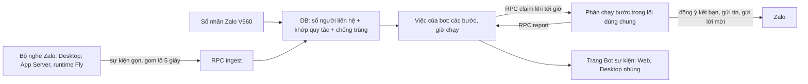

# Bot sự kiện cho akaAgent (Web + Desktop)

> **Trạng thái:** phương án ngày 26/11/2026, chưa code, chưa có migration. Anh yêu cầu "Thêm trang mới, tương ứng với
> tính năng trong akaAgentWebApp và desktop app. Bot sự kiện tương tự tính năng trong akaChat. Lên phương án chi tiết".
> Số liệu lấy bằng truy vấn chỉ đọc trên `akachat` ngày 26/11/2026 (chỉ đếm và đọc cấu trúc bảng).
> Tính năng gốc: akaAgentChatApi `docs/ZALO_EVENT_CHATBOT.md`, `docs/ZALO_CHATBOT_ROLLOUT.md`; giao diện gốc:
> akaAgentChatWeb `app/settings/chatbot/` (trang "Chatbot sự kiện", hai tab "Sự kiện" và "Loại trừ").
> Các câu cần anh chốt nằm ở mục 14, mỗi câu có đề xuất sẵn.

## 1. Mục tiêu

Khách akaAgent cài cho từng tài khoản Zalo một bot tự làm việc khi Zalo có sự kiện: nhận lời mời kết bạn, người lạ
nhắn tin lần đầu, sinh nhật, tin nhắn tới trong khung giờ, thêm hoặc gỡ nhãn. Bot đồng ý kết bạn, gửi tin soạn sẵn,
gửi lời mời kết bạn. Trang cài đặt có trên Web và trong app Desktop, bố cục như trang "Chatbot sự kiện" của akaChat:
cột tài khoản bên trái, dải trạng thái + nút "Nhật ký và báo cáo" + "Dừng bot ngay", tab "Sự kiện" và "Loại trừ",
công tắc chung, khối "quy tắc an toàn luôn áp dụng", mỗi sự kiện một thẻ có công tắc riêng.

## 2. Khảo sát

### 2.1. Chatbot sự kiện của akaChat đang ở đâu

| Mục | Hiện trạng (26/11/2026) |
|---|---|
| Công tắc toàn hệ thống `chat_setting` `zalo.chatbot_event.enabled` | `false` (ảnh anh gửi cũng ghi "đang tắt ở toàn hệ thống") |
| Tài khoản đã cài | 1 (2 quy tắc: Hội thoại mới, Sinh nhật) |
| Việc bot đã tạo (`chat_zalo_chatbot_event_job`) | 0 |
| Bảng trong DB | 9 bảng `chat_zalo_chatbot_*`, có cả hai bảng của "Vào/ra nhóm điều kiện" |
| Nơi chạy | Vòng `chatbot_event` trong `system-worker` của ChatApi (Fly), gửi qua API nội bộ của chatbot |
| Điều kiện tài khoản | Zalo Server có binding Chat (`chat_zalo_account_organization`), quyền app `akaChat` |

Bot akaChat tìm sự kiện bằng cách **đọc dữ liệu Chat đã lưu trong DB**: `chat_zalo_friend_event` (lời mời kết bạn),
`chat_zalo_message` (tin tới, tin của nhân viên, e-card sinh nhật), `chat_zalo_conversation` (hội thoại mới trong 1
giờ), `chat_zalo_account_user.friendship_status` (quan hệ bạn bè), hai bảng tag của hội thoại.

### 2.2. Vì sao không bê nguyên bot akaChat sang akaAgent

Tài khoản Zalo đang đăng nhập của akaAgent (26/11/2026):

| Loại tài khoản | Nơi chạy | Đang đăng nhập | Tổ chức | Có dữ liệu Chat trong DB |
|---|---|---|---|---|
| Zalo Server, tổ chức có akaChat | Fly | 147 | 38 | Có |
| Zalo Server, tổ chức không akaChat | Fly | 273 | 119 | Không (runtime và worker bỏ tin nhắn, hội thoại) |
| Zalo Server | App Server (VPS) | 1.321 | tối đa 578 | Không |
| Zalo QR | Desktop | 874 | 354 | Không |
| Zalo trình duyệt | Desktop | 390 | 142 | Không |

Bot akaChat chỉ phủ được 147 trên 3.005 tài khoản (5%). Phần còn lại không có bảng hội thoại, tin nhắn, lời mời kết
bạn trong DB, và 1.321 tài khoản trên VPS không chuyển sang Fly được (phiên bị Zalo đá khi chép, sự cố 13–14/11).
Vì vậy akaAgent cần **bộ phát hiện sự kiện riêng, lấy sự kiện thẳng từ bộ nghe Zalo ở nơi tài khoản đang chạy**.
Phần dùng lại được của akaChat là hợp đồng quy tắc, cách chống trùng, thứ tự bước, quy tắc an toàn, bố cục trang và
khuôn nhật ký, báo cáo.

### 2.3. akaAgent đã có sẵn những gì

| Thứ có sẵn | Ở đâu | Dùng cho bot |
|---|---|---|
| Bộ nghe Zalo trên Desktop và App Server: `message`, `friend_event`, `reaction`…, `selfListen: true` | `src/main/services/zaloRuntimeService.ts:2692` (`attachZaloListenerHandlers`), `subscribeRealtimeListener` :708 | Nguồn sự kiện cho Zalo QR và Zalo Server trên VPS |
| Bộ nghe **không** bật sẵn: chỉ mở khi có chiến dịch group thời gian thực, sau lần gửi (theo dõi tương tác), hoặc tổ chức có akaChat | `ensureRealtimeListenerReady` :785, `warmCampaignEngagementListener` :2500 | Bot phải giữ bộ nghe cho tài khoản bật bot, theo mẫu `ZaloRealtimeGroupCampaignManager` |
| Mẫu "sự kiện của bộ nghe → gom lô → RPC": theo dõi tương tác, đồng bộ trạng thái tin | `src/shared/zaloCampaignEngagement.ts`, `zaloMessageStatusSync.ts` (cùng mã ở ba repo) | Bot thêm một module cùng kiểu |
| Trên Fly, tổ chức không akaChat vẫn nhận `friend_event` và tin 1-1 của khách; tin tài khoản tự gửi bị bỏ ở runtime | ChatApi `packages/runtime-protocol/src/runtimeEventFilter.ts` | Cần thêm cờ giữ tin tự gửi 1-1 cho tài khoản bật bot |
| Lệnh Zalo: gửi tin, gửi lời mời kết bạn, đọc trạng thái kết bạn, hồ sơ, nhãn | `zaloRuntimeService.ts`: `sendMessageToUser` :1710, `sendFriendRequestToUser` :2222, `getFriendRequestStatus` :1697, `getUserProfile` :1672, `peekLabels` :614 | Các bước của bot |
| **Chưa có** lệnh đồng ý kết bạn trong `zaloRuntimeService` (chỉ có ở đường relay akaChat `zaloLocalChatSyncService.ts:2172`) | | Phải thêm |
| Sổ nhãn Zalo, chỉ ghi nhận người **mới được gắn** | V660: `auto_zalo_tag_members`, `ZaloTagSyncRuntime` | Nguồn cho sự kiện nhãn Zalo; phải thêm chiều gỡ |
| Chiến dịch sinh nhật: đầu lượt đọc danh sách bạn bè, lấy người có `sdob` trùng hôm nay | `packages/campaign-engine/src/zalo/materialize.ts:391` | Dùng lại cho sự kiện Sinh nhật |
| Quy trình tự động: trigger chỉ có "vào Nhóm data" và "kết quả chiến dịch", **không có trigger theo sự kiện Zalo** | WebApp `packages/journey-core/src/types.ts:199` | Bot sự kiện không trùng; "nhóm điều kiện" thì trùng (mục 5) |
| Nhóm loại trừ và danh sách không gửi | V330, V654–V668: `private.aka_agent_send_exclusion_match` | Tab "Loại trừ" |
| Bộ kiểm cú pháp nội dung, ô soạn có biến và nhiều mẫu | WebApp `packages/campaign-core/src/contentSyntax.ts`, `apps/web/src/features/journeys/formControls.tsx` | Ô soạn tin của bot |
| Desktop nhúng trang Web bằng `?embed=desktop`, khung nhúng cho đi mọi đường `/automation/*` | `src/main/services/journeyWebService.ts`, WebApp `apps/web/src/lib/desktopEmbed.ts` | Trang Desktop của bot |
| Lõi engine v2 dùng chung ba nơi chạy, chép sang ChatApi bằng `scripts/sync-campaign-engine.cjs` | `packages/campaign-engine` | Chỗ đặt phần chạy bước của bot |
| Engine v2 **không** gửi lẻ một tin ngoài chiến dịch: mọi lượt cần chiến dịch + dòng data | `contracts.ts:141`, `aka_agent_engine_claim_target_v1` | Xem mục 3 |

## 3. Chọn kiến trúc

| | A. Bê nguyên bot akaChat | B. Mỗi quy tắc là một chiến dịch ẩn | C. Bộ máy riêng của bot (đề xuất) |
|---|---|---|---|
| Cách làm | Bật ghi dữ liệu Chat cho tài khoản bật bot, chạy vòng `chatbot_event` có sẵn | Sự kiện → thêm dòng data vào chiến dịch `[Bot sự kiện] …`, engine v2 gửi (như group thời gian thực, Quy trình, V660) | Nơi chạy đẩy sự kiện gọn vào DB, DB khớp quy tắc và tạo việc, nơi chạy nhận từng bước để gửi |
| Tài khoản phủ được | 420 (chỉ Fly); QR, VPS, trình duyệt không được | QR, VPS, Fly | QR, VPS, Fly |
| Đồng ý kết bạn | Có | Engine chưa có thao tác này, phải thêm vào lõi, cổng Zalo và bảng chính sách | Thêm một lệnh ở ba cổng Zalo |
| Độ trễ | 30–90 giây | Xếp sau chiến dịch đang chạy của cùng tài khoản: có thể hàng giờ (một lượt chiến dịch giữ tài khoản tới khi hết data hoặc chạm hạn mức) | 30–90 giây |
| "Nhân viên đã nhắn thì dừng" | Có | Phải chèn bước kiểm vào hàm nhận lượt đang rất nóng | Kiểm trong hàm nhận bước của bot |
| Đụng hệ đang chạy | Ghi dữ liệu Chat cho tổ chức không mua Chat (bảng tin đã 37 GB) | Sửa `claim_target_v1`, `report_v1`, thêm thao tác mới | Không sửa hàm engine nào; chỉ thêm bảng và RPC mới |
| Hạn mức, lịch sử | Riêng của bot | Chung với chiến dịch (ưu điểm) | Riêng của bot, đọc khoá của chiến dịch |

**Đề xuất C.** Lý do chính: bot phải trả lời trong vòng một hai phút mới có ý nghĩa (chào người vừa kết bạn, trả lời
ngoài giờ), mà chiến dịch ẩn phải xếp hàng sau chiến dịch khác của tài khoản; và C không sửa hàm nào của engine đang
chạy cho hơn 3.000 tài khoản. C giữ nguyên tắc của engine v2: **DB quyết định, nơi chạy chỉ đẩy sự kiện và thực hiện
bước**, nên sửa luật bằng migration có hiệu lực cho mọi bản app đã cài.

## 4. Kiến trúc đề xuất

### 4.1. Sự kiện nơi chạy đẩy lên

Chỉ đẩy cho tài khoản đang bật bot, và chỉ loại sự kiện mà quy tắc đang bật cần. **Không đẩy nội dung tin nhắn.**

| Sự kiện gọn | Lấy từ | Trường |
|---|---|---|
| `friend_request_in` | `friend_event` loại lời mời, người gửi không phải tài khoản | uid, giờ |
| `message_in` | `message` 1-1 của khách | uid, giờ, loại (văn bản, ảnh, tệp, cuộc gọi, hệ thống, e-card sinh nhật) |
| `message_out` | `message` 1-1 tài khoản tự gửi | uid, giờ, nguồn: `app` (chiến dịch hoặc bot vừa gửi, nơi chạy biết mã tin) hay `manual` (nhân viên gõ trên Zalo) |
| `friend_accepted` | `friend_event` loại đã thành bạn | uid, giờ |

Loại e-card sinh nhật nhận bằng hàm thuần chép từ ChatApi `packages/zalo-event-normalizer/src/ecard.ts`.

### 4.2. DB khớp quy tắc

- **Sổ người liên hệ** của bot (`auto_event_bot_threads`): mỗi (tài khoản, uid) một dòng, giữ giờ thấy lần đầu, tin
  tới gần nhất, tin nhân viên gửi gần nhất, tin app gửi gần nhất, lời mời kết bạn đang chờ. Chỉ có dòng cho tài khoản
  bật bot. Đây là phần thay cho bảng hội thoại của akaChat.
- `aka_agent_event_bot_ingest_v1` cập nhật sổ, khớp quy tắc đang bật, tạo việc với khoá chống trùng (cùng dạng khoá
  của akaChat: `new_conversation:<tài khoản>:<uid>`, `birthday:<uid>:<năm>`, `time_window:<quy tắc>:<uid>:<ngày mở
  khung>`, `tag_change:…`), đặt giờ chạy bước đầu theo khoảng chờ ngẫu nhiên của quy tắc. Hàm trả về giờ đến hạn sớm
  nhất của tài khoản để nơi chạy biết lúc nào cần nhận bước.
- Sự kiện nhãn do DB tự sinh khi sổ nhãn V660 đổi (mục 5).

### 4.3. Nơi chạy thực hiện bước

- `aka_agent_event_bot_claim_v1` kiểm lại trong DB ngay trước mỗi bước: bot và quy tắc còn bật, quy tắc chưa sửa,
  nhân viên chưa nhắn sau sự kiện, người nhận không bị loại trừ, thao tác không bị chiến dịch khoá
  (`auto_account_action_status`, chỉ đọc), bot không đang tự tạm dừng, sự kiện chưa quá hạn, tài khoản không có bước
  khác đang gửi. Qua thì đánh dấu bước "đang gửi" kèm khoá idempotency và trả mẫu tin.
- Phần chạy bước viết **một lần** trong `packages/campaign-engine/src/eventBot/`, dùng cổng Zalo sẵn có của từng nơi
  (`desktopZaloPort.ts` cho Desktop và App Server, `flyZaloPort.ts` cho Fly). Ngay trước khi gửi, nó đọc trạng thái
  kết bạn thật (`getFriendRequestStatus`) để chọn bước (đã là bạn thì bỏ đồng ý và bỏ gửi lời mời), đọc hồ sơ để điền
  `#{FULL_NAME}`, `#{SEX{…}}`, dựng nội dung bằng các module nội dung của lõi, rồi gửi.
- `aka_agent_event_bot_report_v1` ghi kết quả. Kết quả không rõ (app tắt giữa lúc gửi) thì **không gửi lại**.
- Thứ tự bước của "Hội thoại mới" giữ như akaChat: đồng ý kết bạn → gửi tin → gửi lời mời kết bạn.

### 4.4. Ba nơi chạy

| Nơi chạy | Tài khoản | Việc phải làm |
|---|---|---|
| Desktop | Zalo QR | `EventBotRuntime` trong tiến trình chính: giữ bộ nghe cho tài khoản bật bot, gom sự kiện, nhận và chạy bước. Chỉ chạy khi app đang mở và máy không ngủ |
| App Server (VPS) | Zalo Server chưa sang Fly | Cùng mã với Desktop (App Server dùng lại `zaloRuntimeService`). Một lượt hỏi DB cho cả tiến trình, như `serverEngineGate.ts` |
| Fly | Zalo Server của tổ chức bật `use_new_zalo_runtime` | ChatApi: thêm cờ `eventBot` vào `eventFilter` để runtime giữ tin tự gửi 1-1 (gắn capability như `event_filter`, vì runtime đọc danh sách theo schema strict); worker gọi ingest ở chỗ đang tách sự kiện theo dõi tương tác; thêm vòng chạy bước dùng lõi đã chép |
| Zalo trình duyệt | | **Không hỗ trợ**: tài khoản loại này không có bộ nghe (`zaloWebRuntimeService.ts:925` thay `listener.start` bằng hàm báo lỗi). Trang hiện rõ "Zalo trình duyệt chưa dùng được bot sự kiện" |

### 4.5. Tổ chức có akaChat

147 tài khoản Server của 38 tổ chức có akaChat đã có "Chatbot sự kiện" bên akaChat. Hai bot cùng bật trên một tài
khoản thì khách nhận hai tin. Đề xuất: tài khoản có binding Chat của tổ chức có akaChat **dùng bot của akaChat**;
trang akaAgent hiện tài khoản đó ở trạng thái "Cài ở akaChat" kèm link, và hàm lưu cài đặt của akaAgent từ chối bật.

## 5. Sự kiện: akaChat so với akaAgent

| Sự kiện akaChat | akaAgent | Đợt | Khác akaChat ở đâu |
|---|---|---|---|
| Hội thoại mới | Có | 1 | Không có bảng hội thoại nên "mới" nghĩa là: lần đầu bot thấy người này kể từ khi bật, người đó chưa là bạn (đọc trạng thái thật lúc chạy), và trước sự kiện chưa có tin đi nào mà bot biết (tin nhân viên, tin chiến dịch của tài khoản tới uid đó). Người lạ đã nhắn từ trước khi bật bot, nay nhắn lại, sẽ được coi là mới **một lần** |
| Sinh nhật | Có | 1 | Đề xuất lấy danh sách bạn bè có sinh nhật hôm nay (mã của chiến dịch sinh nhật, chạy mỗi ngày một lần khi tài khoản sẵn sàng) thay vì chờ e-card: không phụ thuộc app Desktop có đang mở đúng lúc Zalo báo hay không. Bỏ qua người đã nhận tin của chiến dịch `zalo_message_birthday` trong ngày |
| Tin nhắn theo khung giờ và nhãn | Có | 1 | Đề xuất cho để trống nhãn ("mọi khách") vì trả lời tự động ngoài giờ là nhu cầu phổ biến nhất; akaChat bắt buộc chọn nhãn. Quy tắc có chọn nhãn thì cần sổ nhãn V660 cho tài khoản đó |
| Thêm/gỡ nhãn Zalo | Có | 2 | Mở rộng sổ nhãn V660 ghi cả chiều gỡ, cho tài khoản có quy tắc nhãn. Desktop và App Server hỏi nhãn 60 giây một lần; Fly chỉ báo khi nhãn đổi |
| Thêm/gỡ nhãn hệ thống | Có | 2 | Nhãn hệ thống của akaAgent là `auto_contact_tags` gắn trên liên hệ; phát hiện bằng so ảnh chụp như akaChat |
| Vào/ra nhóm điều kiện | **Không làm trong bot** | | akaAgent đã có Nhóm data lọc động (chính là công thức akaChat mượn) và Quy trình tự động chạy khi khách vào Nhóm data. Trang bot đặt một thẻ dẫn sang "Quy trình tự động" |

Quy tắc luôn áp dụng, giữ như akaChat: chỉ người nhận cá nhân (không nhóm Zalo); nhân viên đã nhắn sau sự kiện thì
việc dừng hẳn (với khung giờ và nhãn: tính cả tin gửi 2 phút trước sự kiện); luôn bỏ qua người bị loại trừ; không
làm dồn sự kiện cũ (quá 1 giờ, quá ngày sinh nhật, quá 30 phút thì bỏ); tôn trọng khoá thao tác của chiến dịch; chỉ
gửi văn bản, cùng cú pháp biến và spin với chiến dịch, cắt ở 2.000 ký tự (lời nhắn kết bạn 150).

## 6. Dữ liệu (chỉ thêm, không sửa bảng đang có)

| Bảng | Nội dung |
|---|---|
| `auto_event_bot_settings` | Mỗi tài khoản một dòng: công tắc chung, công tắc từng sự kiện, lựa chọn loại trừ, mốc tự tạm dừng và lý do, `revision`, người sửa |
| `auto_event_bot_rules` | Quy tắc: loại sự kiện, tên, bật/tắt, thứ tự, `revision`, `conditions` / `actions` / `schedule` dạng JSON **cùng khuôn với akaChat** (`ChatbotEventRuleStored`), khoảng cách tối thiểu |
| `auto_event_bot_threads` | Sổ người liên hệ (mục 4.2) |
| `auto_event_bot_jobs` | Việc: quy tắc và `revision`, uid, sự kiện gốc, khoá chống trùng duy nhất, trạng thái, các bước, giờ chạy bước kế, hạn, lý do bỏ qua, mã lỗi. Không lưu câu khách đã nhận, chỉ lưu mẫu tin |

- RLS bật, thu hồi quyền bảng; mọi truy cập qua RPC.
- RPC cho trang: `aka_agent_control_event_bot(staff, org, action, payload)`, chỉ `service_role`, API Web gọi
  (`accounts`, `get`, `save`, `stop`, `log`, `log_detail`, `report`). Lưu có kiểm `revision` để báo "người khác vừa sửa".
- RPC cho nơi chạy: `aka_agent_event_bot_sync_v1` (tài khoản nào bật, cần loại sự kiện nào, giờ đến hạn),
  `…_ingest_v1`, `…_claim_v1`, `…_report_v1`. Desktop gọi theo phiên (`aka_agent_desktop`, chỉ tài khoản của chính
  nhân viên), App Server bằng `service_role`, Fly bằng `aka_agent_chat_api`.
- Công tắc `auto_system_settings` `event_bot`: `{"audience":"off|admin_akabiz|orgs|all","organizationIds":[],
  "runtimes":{"desktopMinVersion":"…","server":false,"fly":false}}`, migration đặt `off`.
- Dọn dữ liệu: việc đã đóng và dòng sổ không hoạt động quá 90 ngày, bằng job pg_cron như bảng engine.
- Hợp đồng dùng chung `eventBot.ts` đặt ở WebApp `packages/control-api`, chép nguyên văn sang akaAgent `src/shared`
  (bài kiểm giữ md5 như các hợp đồng khác). Hàm kiểm quy tắc, kế hoạch bước, khung giờ, khoá chống trùng, khuôn báo
  cáo chép từ ChatApi `packages/chat-domain/src/chatbotEvent.ts`, `chatbotEventReport.ts`.

## 7. Giao diện

### 7.1. Web

- Trang mới **"Bot sự kiện"**, đường dẫn `/automation/event-bot`, mục menu riêng ngay dưới "Tự động hóa"
  (`apps/web/src/components/AppShell.tsx`), ẩn với tổ chức chỉ có Facebook. Đường dẫn nằm dưới `/automation/` để
  khung nhúng của Desktop đi được mà không phải sửa luật nhúng.
- Bố cục theo ảnh anh gửi:
  1. Cột trái: tài khoản Zalo của nhân viên, ô tìm, trạng thái từng tài khoản (Đang bật, Đang tắt, Cài ở akaChat,
     Chưa dùng được).
  2. Dải trạng thái của tài khoản đang chọn: bot đang chạy hay không và **vì sao** (app Desktop đang tắt, app cần cập
     nhật, tài khoản chưa đăng nhập, bot đang tự tạm dừng tới giờ nào, tính năng chưa mở); nút "Nhật ký và báo cáo",
     "Dừng bot ngay".
  3. Tab "Sự kiện": công tắc chung; khối "quy tắc an toàn luôn áp dụng"; thẻ Hội thoại mới, Sinh nhật, Tin nhắn theo
     khung giờ và nhãn (đợt 1); Thêm/gỡ nhãn Zalo, Thêm/gỡ nhãn hệ thống (đợt 2); thẻ dẫn sang Quy trình tự động.
  4. Tab "Loại trừ": chọn nhóm loại trừ và danh sách không gửi có sẵn (thẻ "Không gửi cho"), cộng danh sách người bot
     không nhắn của riêng tài khoản (thêm bằng SĐT hoặc từ một dòng nhật ký).
  5. Thanh lưu ở chân trang: "Đang bật N sự kiện cho <tài khoản>. Sửa lần cuối lúc …", nút Bỏ thay đổi, Lưu thay đổi.
- Trạng thái "bot có đang chạy không" của Zalo QR lấy từ `auto_staff_device_presence.runtime_state` (thêm khối
  `eventBot` vào ảnh chụp bộ chạy mà Desktop đã gửi mỗi 30 giây); của Zalo Server lấy từ lần hỏi DB gần nhất của App
  Server hoặc Fly.
- Ô soạn tin dùng `ContentVariants` và danh sách biến của form Quy trình, kiểm bằng `contentSyntax.ts` (kênh mới
  `event_bot`: biến cột file `#{INPUT_…}` không điền được nên bị chặn).
- Trang "Nhật ký và báo cáo": theo tài khoản, khoảng ngày tối đa 90 ngày; số sự kiện khớp, đã gửi, bỏ qua, hết hạn,
  lỗi; lý do theo từng mã; danh sách từng việc và chi tiết từng bước. Cùng khuôn với akaChat.
- Lần đầu bật có hộp xác nhận như akaChat: "Bot sự kiện không có chạy thử: ngay lần đầu có sự kiện khớp, bot làm việc
  thật với khách".

### 7.2. Desktop

- Mục menu "Bot sự kiện" (chỉ khi có gói Zalo) mở trang Web trong khung nhúng `?embed=desktop`, dùng chung phiên và
  phân vùng với thẻ Quy trình. Việc phải làm: tách `JourneyWebService` thành dịch vụ nhúng nhận đường mặc định và tiêu
  đề (hiện viết cứng `/automation` và chữ "Tự động hóa"), thêm trang vào `TopBar.tsx` và `App.tsx`.
- WebApp `EmbedShell` cho trang mới hiện trong khung nhúng (ẩn thanh bên, giữ điều hướng trong trang).
- Bản Desktop cũ không có mục menu; khách vẫn cài trên Web, nhưng bot của Zalo QR chỉ chạy khi máy đã lên bản Desktop
  có `EventBotRuntime`. Dải trạng thái nói rõ điều này.

### 7.3. iOS

Để sau đợt 2. API dùng chung nên chỉ thêm màn hình.

## 8. An toàn

- **Không có chạy thử**, như akaChat. Mặc định mọi thứ tắt; bật cho tài khoản nào thì tài khoản đó chạy.
- **Tôn trọng khoá của chiến dịch** (chỉ đọc `auto_account_action_status`: `zalo_add_friend`, `zalo_message_friend`,
  `zalo_message_stranger`). Bot không cộng vào bộ đếm hạn mức của chiến dịch.
- **Tự tạm dừng khi Zalo báo lỗi thuộc về tài khoản**, cùng danh sách mã của akaChat: 120, 802, 223 dừng đúng loại
  thao tác 24 giờ; mã của riêng một người nhận (122, 119, 126, 127, 251, 225, 222, 215, 114) không dừng.
- **Hai chốt riêng của akaAgent**, vì tài khoản akaAgent còn chạy chiến dịch sát hạn mức của Zalo:
  - Zalo trả thành công mà không có mã tin (Zalo bỏ tin thứ 31 trong 30 phút, đo 20/11): bước ghi "không gửi được",
    bot tạm dừng gửi tin của tài khoản 30 phút;
  - mã 221 "vượt quá số request": tạm dừng thao tác đó 60 phút.
- **Gắn nhãn hàng loạt** (đợt 2): chiến dịch akaAgent gắn nhãn cho hàng trăm người một lượt, quy tắc "được gắn nhãn
  thì gửi tin" sẽ gửi ngần ấy tin. akaChat đã bỏ ngưỡng hàng loạt ngày 19/11; với akaAgent cần anh chốt (mục 14,
  câu 6).
- **Bật bot không gửi gì cho người cũ**: sổ người liên hệ và sổ nhãn chụp mốc lúc bật; chỉ sự kiện sau lúc bật mới
  tạo việc.
- **Mỗi tài khoản một bước đang gửi**; bước kế của việc khác chờ.
- Không lưu và không gửi lên DB nội dung tin nhắn của khách.

## 9. Tài nguyên và số request

- Tài khoản không bật bot: không mở thêm bộ nghe, không thêm request.
- Desktop đọc danh sách tài khoản bật bot lúc đăng nhập và 2 phút một lần **chỉ khi** công tắc `event_bot` mở cho tổ
  chức (đọc chung câu đọc cài đặt lúc đăng nhập); bật bot trên Web có hiệu lực trên máy đang mở trong tối đa 2 phút.
- Tài khoản bật bot: sự kiện gom 5 giây gửi một lô, chỉ khi có sự kiện; nhận bước khi tới giờ đến hạn DB đã báo; một
  lượt hỏi DB mỗi 60 giây cho cả tiến trình để bắt việc do DB tự sinh (nhãn) và cài đặt vừa đổi.
- App Server gom mọi tài khoản bật bot của VPS vào một lượt gọi, không gọi theo từng tài khoản.
- Mỗi tài khoản bật bot giữ một kết nối bộ nghe Zalo. Theo dõi tương tác và đồng bộ trạng thái tin đang bật nên bộ
  nghe vốn đã được mở sau mỗi lần gửi tin 1-1 của chiến dịch; bot giữ nó mở liên tục.
- Trần sự kiện mỗi tài khoản mỗi ngày (mặc định 20.000), quá thì bỏ sự kiện `message_in` thừa và ghi một dòng lý do.
- Các hàm ingest, claim, report đặt `statement_timeout` riêng và chỉ tra theo khoá của tài khoản.

## 10. Việc phải làm theo repo

| Repo | Việc |
|---|---|
| akaAgent (DB) | Migration bảng + RPC + công tắc + job dọn; bản gỡ; bộ sinh SQL và bài kiểm PG17 |
| akaAgent (lõi) | `packages/campaign-engine/src/eventBot/`: chạy bước, chọn bước theo quan hệ, dựng nội dung, xếp loại lỗi; cổng Zalo thêm `acceptFriendRequest`, `getFriendRequestStatus` |
| akaAgent (Desktop, App Server) | `EventBotRuntime` (giữ bộ nghe, gom sự kiện, nhận và chạy bước), `zaloRuntimeService.acceptFriendRequest`, khối `eventBot` trong ảnh chụp bộ chạy, sinh nhật theo danh sách bạn bè; dịch vụ nhúng dùng chung, mục menu, trang |
| akaAgentWebApp | Hợp đồng `eventBot.ts`; route API `/event-bot/*`; trang, hai tab, nhật ký và báo cáo; kênh `event_bot` của bộ kiểm cú pháp; mục menu; chế độ nhúng |
| akaAgentChatApi | Cờ `eventBot` của `eventFilter` + capability; worker gọi ingest; vòng chạy bước (lõi chép bằng `sync-campaign-engine.cjs`); chặn bật hai bot trên một tài khoản. Không đổi bot akaChat |
| akaAgentChatWeb | Không đổi |

## 11. Các đợt

| Đợt | Nội dung | Tài khoản phủ |
|---|---|---|
| 0 | Anh chốt mục 14; em làm bản thiết kế giao diện để anh duyệt | |
| 1 | DB + lõi + Desktop + App Server + trang Web + khung nhúng Desktop; ba sự kiện: Hội thoại mới, Sinh nhật, Tin nhắn theo khung giờ (và nhãn); nhật ký và báo cáo | Zalo QR 874 + Server trên VPS 1.321 |
| 2 | Fly (ChatApi); Thêm/gỡ nhãn Zalo; Thêm/gỡ nhãn hệ thống | Thêm Server trên Fly không akaChat 273 |
| 3 | iOS; xuất nhật ký; số "khách trả lời sau tin của bot" (dùng dữ liệu theo dõi tương tác) | |

## 12. Kiểm thử

- **SQL (PG17 cục bộ):** từng loại sự kiện, chống trùng, hạn tuổi, nhân viên đã nhắn, loại trừ, khoá chiến dịch, tự
  tạm dừng, hai lượt nhận bước đồng thời, mất câu trả lời của DB rồi gọi lại, bản gỡ.
- **Lõi:** bài kiểm phần chạy bước với cổng Zalo giả (mọi trạng thái kết bạn, lỗi từng mã, app tắt giữa lúc gửi).
- **Mô phỏng:** bộ nghe giả phát chuỗi sự kiện (khách vừa gửi lời mời vừa nhắn, nhân viên chen vào, app tắt rồi mở,
  đồng hồ máy lệch) qua `EventBotRuntime` thật và DB thật; bất biến: không ai nhận hai tin cho một sự kiện, không gửi
  sau khi nhân viên nhắn, không gửi cho người bị loại trừ, không gửi sự kiện quá hạn.
- **Phát lại dữ liệu thật (chỉ đọc):** chuỗi `friend_event` và tin tới 7 ngày của vài tài khoản tổ chức có akaChat
  (đã có trong `chat_zalo_runtime_event`), so số việc bot akaAgent tạo với số bot akaChat sẽ tạo trên cùng chuỗi.
- **Giao diện:** bài kiểm trang với API giả; bài kiểm khung nhúng trên Electron.
- **Thử thật:** tài khoản thử của tổ chức 1, lần lượt Zalo QR trên app dev, Zalo Server trên VPS, rồi Fly.

## 13. Triển khai, gỡ, rủi ro

Thứ tự: apply migration (mọi công tắc tắt) → deploy API và Web → phát hành Desktop và cài App Server → mở
`event_bot` cho admin akaBiz → vài tổ chức → mọi khách. Đợt 2: deploy ChatApi `api` → `zalo_runtime` → `worker`.

Gỡ theo mức: tắt một sự kiện của tài khoản → "Dừng bot ngay" → `event_bot` về `off` (nơi chạy ngừng trong tối đa 2
phút, hàm claim từ chối ngay) → bản gỡ migration.

| Rủi ro | Cách xử lý |
|---|---|
| Zalo khoá tài khoản vì bot tự kết bạn, tự nhắn người lạ | Đọc khoá chiến dịch; tự tạm dừng theo mã lỗi; hai chốt ở mục 8; mở dần |
| Bot của Zalo QR không chạy khi app tắt hoặc máy ngủ, khách tưởng bot hỏng | Dải trạng thái nói rõ lý do; sự kiện lúc app tắt không được làm bù (đúng quy tắc không làm dồn) |
| "Hội thoại mới" không chính xác bằng akaChat | Ghi rõ trên thẻ; đọc trạng thái kết bạn thật trước khi chạy; chụp mốc lúc bật |
| Nhận nhầm tin của chiến dịch thành tin nhân viên (bot dừng oan) hoặc ngược lại | Nơi chạy đánh dấu tin do app gửi bằng mã tin; DB đối chiếu thêm với lần gửi gần nhất của chiến dịch tới uid đó |
| Hai bot (akaChat, akaAgent) cùng gửi | Mục 4.5 |
| Giữ bộ nghe cho nhiều tài khoản trên VPS | Chỉ tài khoản bật bot; dùng `startZaloListenerGuarded` / `stopZaloListenerGuarded` đã có |
| Thêm request từ đàn Desktop | Mục 9; không ai bật thì không thêm gì |

## 14. Cần anh chốt

| # | Câu hỏi | Đề xuất |
|---|---|---|
| 1 | Kiến trúc | **C**: bộ máy riêng của bot, không sửa engine chiến dịch (mục 3) |
| 2 | Vị trí trang | Mục menu riêng "Bot sự kiện" dưới "Tự động hóa" trên Web và Desktop; Desktop nhúng trang Web như thẻ Quy trình |
| 3 | Loại tài khoản | Đợt 1: Zalo QR và Zalo Server trên VPS. Đợt 2: Zalo Server trên Fly. Zalo trình duyệt không hỗ trợ |
| 4 | Tổ chức có akaChat | Tài khoản đã có trong akaChat thì dùng bot của akaChat, trang akaAgent chỉ dẫn link |
| 5 | Sự kiện | Đợt 1: Hội thoại mới, Sinh nhật, Tin nhắn theo khung giờ (nhãn không bắt buộc). Đợt 2: thêm/gỡ nhãn Zalo, nhãn hệ thống. Nhóm điều kiện: không làm, dẫn sang Quy trình tự động |
| 6 | Giới hạn | Như akaChat: không có trần số tin, không cộng hạn mức chiến dịch, chỉ đọc khoá. Thêm hai chốt ở mục 8. Riêng sự kiện nhãn: giữ ngưỡng "hơn 20 người đổi cùng một nhãn trong một lượt quét thì không gửi" (akaChat đã bỏ) |
| 7 | Sinh nhật | Theo danh sách bạn bè có sinh nhật hôm nay, gửi vào giờ cố định (mặc định 08:30), mỗi người một lần mỗi năm |
| 8 | "Hội thoại mới" | Định nghĩa ở mục 5; chấp nhận người lạ cũ được coi là mới một lần |
| 9 | Quyền | Nhân viên cài bot cho tài khoản Zalo của chính mình, như chiến dịch |
| 10 | Nội dung | Chỉ văn bản, cú pháp như chiến dịch, như akaChat |
| 11 | Lịch sử | Nhật ký riêng của bot; không ghi vào "Lịch sử hành động" và báo cáo chiến dịch |
| 12 | Đối tượng | Mọi khách có gói Zalo; mở dần bằng công tắc `event_bot` |

Chưa xác minh, sẽ kiểm ở bước thiết kế kỹ thuật: bộ nghe trên Desktop có nhận đủ e-card sinh nhật không (chỉ cần nếu
anh chọn sinh nhật theo thông báo của Zalo); `friend_event` của zca-js có phân biệt được lời mời tới với lời mời do
chính tài khoản gửi trên mọi nơi chạy không (ChatApi đang dựa vào `is_self`); chi phí giữ bộ nghe cho vài trăm tài
khoản trên App Server.
