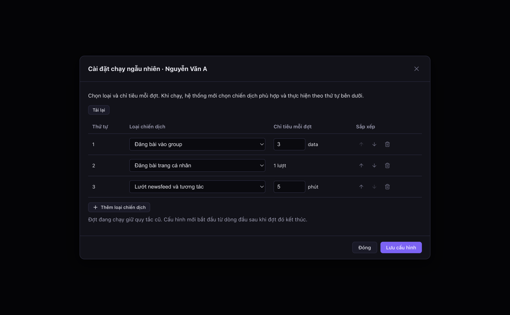
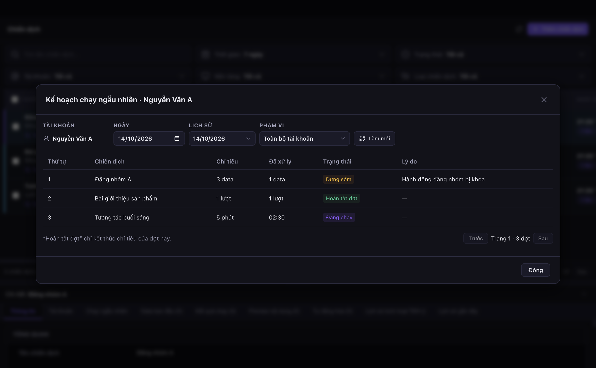

# Facebook — Chạy ngẫu nhiên theo quy tắc tài khoản (V387)

V387 đã apply trên **akachat** (`cgjbsmqtfhqvttudyjzq`) lúc 15:20 ngày 14/10/2026, history `20261014082051 / migration_v387_facebook_random_run`. **Không apply lại.** Sau apply: 0 tài khoản bật, 0 bản ghi ngày. Desktop đã build local; chưa đóng gói hoặc phát hành bộ cài trong task này.

**Logic [V389](FACEBOOK_RANDOM_RUN_LIFECYCLE_V389.md) đã được khôi phục qua [V392](FACEBOOK_RANDOM_RUN_RESTORE_V392.md) lúc 16:44 ngày 14/10/2026**, sau lần hoàn nguyên V391. Giữ tính năng V387, cấu hình và lịch sử. Audit/checksum hiện hành và hai finding còn lại nằm trong tài liệu V392; không chạy lại audit/apply các migration cũ.

## Sử dụng

Menu tài khoản Facebook có **Chạy ngẫu nhiên / Dừng chạy ngẫu nhiên**, **Cài đặt chạy ngẫu nhiên**, **Xem tiến trình chạy ngẫu nhiên**. Bật thành công hiện nhãn **Chạy ngẫu nhiên**; nhãn thể hiện chế độ, kể cả khi đang chờ lịch/data. Bật không tự đăng nhập hoặc tiếp tục tài khoản tạm dừng. Chưa có cấu hình thì mở form và lưu trước khi bật.

Form chọn **loại chiến dịch**, không chọn chiến dịch cụ thể. Người dùng chỉ sửa bằng bảng, dùng nút **Thêm loại chiến dịch**, xóa/đổi thứ tự và lặp loại. Không có tab hoặc trình sửa JSON; chỉ tiêu đầu vào hiển thị đơn vị **data**. Danh mục lấy từ catalog Facebook đang hoạt động, đã lọc quyền sản phẩm. Từ 1 đến 100 dòng; số lượng/phút nguyên dương (tối đa số nguyên PostgreSQL). Revision được quản lý nội bộ: DB tăng sau khi lưu, request giữ revision cũ để chống ghi đè thay đổi từ máy khác; vẫn có nút **Tải lại** khi xung đột.

JSON sau chỉ là định dạng lưu dữ liệu nội bộ, không phải giao diện cho người dùng nhập:

```json
{
  "version": 1,
  "revision": 1,
  "rules": [
    { "campaignActionId": "facebook_group_post", "quantity": 3, "unit": "data" },
    { "campaignActionId": "facebook_timeline_post", "quantity": 1, "unit": "run" },
    { "campaignActionId": "facebook_newsfeed_interaction", "quantity": 5, "unit": "minute" }
  ]
}
```

- Loại có data: tối đa N đối tượng đã thực thi và có kết quả cuối; thành công/thất bại đều tính một đối tượng. Quota nghiệp vụ giữ policy riêng. Bước lấy đề xuất, kết quả tìm kiếm, log và thao tác phụ không tiêu chỉ tiêu. Group chia sẻ phụ và batch mời nhóm bị giới hạn bởi phần chỉ tiêu còn lại.
- Đăng trang cá nhân: cố định 1 lượt. Newsfeed: thời lượng của đợt được truyền vào biến workflow, không ghi đè `extraSettings.newsfeedTimeMinutes` của chiến dịch.
- Có ít data hơn chỉ tiêu thì kết thúc sau phần còn lại. Hết chỉ tiêu nhưng còn data thì trả chiến dịch về chờ xử lý. Hoàn thành/lịch chạy lại vẫn qua executor hiện tại.
- Sửa cấu hình trong đợt: đợt giữ snapshot cũ; các dòng chưa chạy bị bỏ qua với lý do cấu hình đổi; vòng kế tiếp bắt đầu từ dòng đầu cấu hình mới.



Mục **Xem tiến trình chạy ngẫu nhiên** ở menu tài khoản mở **modal** xem toàn bộ tài khoản, không mở hoặc đổi tab ở vùng chi tiết bên dưới. Tab **Chạy ngẫu nhiên** trong chi tiết chiến dịch vẫn giữ để xem theo chiến dịch. Hai nơi dùng chung bảng với ngày theo giờ Việt Nam, danh sách ngày có lịch sử và phân trang 100 đợt; tab chiến dịch cho đổi phạm vi toàn tài khoản/chiến dịch đang xem. Thứ tự, tên chiến dịch, chỉ tiêu, đã xử lý, trạng thái và lý do lấy từ output đã lưu; hover thứ tự xem vòng/dòng/revision. Chỉ tiêu/tiến độ đầu vào hiển thị **data**, thời lượng newsfeed hiển thị `mm:ss`. Không có nút tải file hoặc trình xem JSON output.

Tab **Chạy ngẫu nhiên** chỉ hiện khi tài khoản của chiến dịch Facebook đang bật chế độ này. Nếu tắt chế độ khi đang xem tab, chuyển về **Thông tin** và ngừng đọc tiến trình trong tab. Menu **Xem tiến trình chạy ngẫu nhiên** vẫn mở được lịch sử trong modal khi chế độ đã tắt.

Modal hỗ trợ nút Đóng và Escape, giữ focus bên trong bằng dialog native. Đóng modal hoặc ẩn trang thì gỡ panel và subscription; khi modal đang mở, tab chạy ngẫu nhiên phía sau tạm ngừng đọc. Vẫn dùng coordinator UI hiện có, không thêm polling.

Bộ lọc tab/modal dùng style chung của bộ lọc chi tiết: nhãn phía trên, control cao 30px, màu nền/viền theo theme, mũi tên và nút Làm mới có icon. Đã kiểm tra giao diện tối/sáng ở chiều rộng 850/1250px; giữ nguyên hành vi ngày, lịch sử, phạm vi và điều kiện hiện tab.

Các trạng thái: Chờ chạy, Đang chạy, Hoàn tất đợt, Dừng sớm, Bỏ qua, Không chạy — hết ngày. “Hoàn tất đợt” không đồng nghĩa toàn chiến dịch hoàn thành. Không có bản ghi thì hiện “Chưa có đợt chạy ngẫu nhiên trong ngày này”.



## Dữ liệu và API

Chỉ thêm hai cột trên `auto_accounts`:

| Cột | Kiểu/default | Ý nghĩa |
| --- | --- | --- |
| `facebook_random_run_enabled` | boolean NOT NULL / false | Bật/tắt chế độ |
| `facebook_random_run_config` | jsonb / NULL | Version, revision, rules |

Chỉ thêm một bảng `public.auto_account_random_run_days`:

| Cột | Kiểu | Ý nghĩa |
| --- | --- | --- |
| id | bigint identity PK | Định danh ngày |
| account_id | bigint FK | Tài khoản |
| staff_id | bigint FK | Nhân viên |
| organization_id | bigint FK | Tổ chức |
| run_date | date | Ngày Việt Nam |
| state | jsonb | Vòng, danh sách đợt và snapshot cấu hình theo revision |
| status | text | open/closed |
| created_at | timestamptz | Thời điểm tạo |
| updated_at | timestamptz | Thời điểm cập nhật |

Unique `(account_id, run_date)`; thêm index account cho ngày còn mở. Không thêm cột khóa action, cron, TTL hay job xóa. Giữ lịch sử không thời hạn. Bảng và sequence bật RLS/revoke quyền trực tiếp của PUBLIC/anon/authenticated; đọc/ghi thông qua RPC có credential và kiểm tra staff/org/account Facebook.

`aka_agent_facebook_random_run(bigint,bigint,text,text,bigint,text,jsonb)` có thao tác get/save/toggle/dates/day và thao tác nội bộ plan/claim/finish/progress. Main-frame IPC chỉ cho get/save/toggle/dates/day; renderer không nhận API ghi tiến độ. Token claim/unit bị loại khỏi response đọc bảng. Ngày trả tối đa 100 dòng, danh sách ngày phân trang theo ngày trước đó.

Snapshot tài khoản chỉ thêm enabled/revision, không tải JSON cấu hình hay output. Account repository dùng projection `facebook_random_run_revision:facebook_random_run_config->>revision`, đã smoke qua PostgREST. Output chỉ tải khi panel đang hiện, dùng tín hiệu `campaignsReadAt` từ coordinator UI hiện có; phản hồi cũ bị loại sau đổi tài khoản/chiến dịch/ngày/auth. Không thêm polling riêng, listener, SQL client/pool, process hoặc nguồn connection. RPC dùng singleton Supabase HTTP hiện có.

## Điều phối và phục hồi

1. Scheduler lấy settings và ứng viên từ runtime khi tài khoản đủ điều kiện. Lọc loại trong rules, lịch, cutoff, trạng thái, quyền, workflow, khóa/quota hiện có và data đến lịch. Chưa có data thì chờ; đề xuất bạn bè đi qua bước vật hóa data hiện có.
2. Mỗi dòng chọn đều ngẫu nhiên một ứng viên cùng loại; giữ nguyên thứ tự dòng và dòng lặp. DB xác minh scope/action/order/revision, lưu vòng trước thực thi. Không tạo trước cả ngày; không có ứng viên thì không tạo ngày/vòng rỗng.
3. Trước đợt kiểm tra lại chiến dịch; trước unit kiểm tra action/limit và ownership. Campaign không còn chạy được ghi Bỏ qua hoặc Dừng sớm với lý do, tiếp tục dòng sau. Tất cả bị chặn thì trả về tick hiện tại, không vòng lặp bận. Mở khóa thì xét lại ở vòng mới.
4. Dùng claim v2 cũ qua wrapper có turn ID; nhận theo thứ tự và token. Unit claim chặn vượt budget/chuyển chế độ. Unit settle cập nhật tiến độ trong cùng transaction, trước khi xóa lease; retry token cũ không tăng lần hai. Main đọc lại tiến độ đã commit trước khi chuyển unit/đợt. Giữ sleep và policy/quota gốc.
5. Bật giữa lượt thường: unit đã nhận được kết thúc; unit tiếp theo bị gate và scheduler chuyển sang ngẫu nhiên. Dừng lưu flag ngay, bỏ qua đợt chưa bắt đầu; unit hiện tại được kết thúc (newsfeed là cả phiên). Lượt scheduler sau quay về thường. Client cũ không có random context bị checked-claim/unit-gate từ chối khi flag bật.
6. Recovery chỉ chạy sau các guard idle/ownership hiện có. Data đã có kết quả cuối được tính; input đã được unit nhận nhưng kết quả chưa rõ được giữ không tự thực hiện lại, ghi chú gián đoạn. Timeline/newsfeed chưa rõ kết quả tạm dừng để kiểm tra. Không tự xóa claim nhằm nhận đợt mới. Sau recovery, đợt gián đoạn được đóng với lý do; phần chưa nhận mới có thể tiếp tục ở vòng sau.
7. Giữ cutoff giờ dừng/23:59 và lease ngày cũ. Unit đã bắt đầu ghi kết quả vào ngày nhận unit, kết thúc thực tế sau nửa đêm vẫn giữ timestamp thật. Đợt chưa bắt đầu ngày cũ thành hết ngày; đóng ngày cũ sau finish hoặc recovery xác nhận hết ownership. Ngày mới tạo khi có vòng thực tế, xét lại lịch/data, không phát lại nguyên kế hoạch cũ. Nếu không có hoạt động, đóng lịch sử cũ khi runtime tiếp theo xử lý, không tạo job nền.

Sửa Desktop ngày 14/10/2026: kiểm tra hết hạn dùng chung `isDataGroupCampaignHardEnded` với luồng thường. Chỉ chiến dịch nguồn `data_group` bị chặn trước thực thi bởi ngày kết thúc; chiến dịch data trực tiếp có ngày kết thúc cũ vẫn theo lịch và lifecycle hiện có. Không sửa lịch hoặc trạng thái tài khoản/chiến dịch trên DB.

Sau khi executor kết thúc cả khoảng nghỉ và xác nhận đợt `data` đã hoàn tất, ghi thêm đúng một dòng vào log tiến trình chiến dịch: `✅ Hoàn tất đợt chạy ngẫu nhiên: đã xử lý 1/1 data.` Số liệu lấy từ kết quả đã xác nhận; không ghi dòng này khi bỏ qua, dừng sớm, chưa xử lý data hoặc chưa xác nhận kết thúc. Giữ các log bắt đầu, nghỉ, pause và lỗi hiện có.

Phần sửa Desktop trên chưa đủ: planner SQL vẫn từng chặn data trực tiếp theo ngày kết thúc cũ. [V396](FACEBOOK_RANDOM_RUN_SCHEDULE_V396.md) đã apply ngày 14/10/2026 để đồng bộ đúng điều kiện trong RPC; smoke mới chạy xuyên scheduler và SQL thật, không chỉ mock planner. Không apply lại V387/V392 để triển khai bản sửa này.

[V397](CAMPAIGN_SHARED_SCHEDULE_V397.md) đã gom kiểm tra lịch: hai hàng đợi Desktop dùng chung `isWithinCampaignDispatchSchedule`; planner và checked claim trong DB dùng `private.campaign_dispatch_schedule_allowed`. Giữ nguồn giờ, cutoff legacy/v2, hard-end lifecycle và hợp đồng RPC để app cũ tiếp tục gọi được. Đây là refactor giữ hành vi V396, không chuyển toàn bộ policy về DB và không bỏ kiểm tra trước khi nhận lượt.

## Audit RPC và triển khai

[Migration canonical](../migrations/migration_v387_facebook_random_run.sql), [source live](../migrations/snapshots/facebook-random-run-v387/source.json), [target](../migrations/snapshots/facebook-random-run-v387/target.json), [biên nhận apply](../migrations/snapshots/facebook-random-run-v387/apply.json), [kiểm chứng sau apply](../migrations/snapshots/facebook-random-run-v387/after.json).

Đọc đúng signature live bằng `pg_get_functiondef()` trước khi dựng SQL. Preflight fail-closed trên chín function nguồn. Giữ owner, security mode, volatility, search_path/timeout và ACL của tất cả function cũ; source/target/after lưu đầy đủ các thuộc tính. Giữ admission và lock order staff/campaign/account/input hiện tại, token retry/cutoff/recovery v231/v268, checked-claim v340, quyền snapshot và timeout 60 giây v327 cùng identity hiện có. Không lấy body migration cũ để ghi đè live.

| Signature public thay đổi | MD5 nguồn | MD5 sau apply |
| --- | --- | --- |
| `aka_agent_claim_campaign_run_unit_v2(bigint,bigint,bigint,text,uuid,date,uuid,bigint[])` | `35d402155b69cc393621092d752605e5` | `bc35534b174333a0012c3bf84ca81ef2` |
| `aka_agent_claim_campaign_runtime_checked(bigint,bigint,bigint,text)` | `3e7288046c6d08a25fef71468c8e03c9` | `015ca302742b88e140913a978c0156b5` |
| `aka_agent_desktop_account_snapshot(bigint,bigint,text,text,jsonb,text)` | `4cefacf78def24a3b0fc4d8164ddf7a8` | `c2fcb127716bc511d36d8f0763fcc07b` |
| `aka_agent_settle_campaign_run_unit_v2(bigint,bigint,bigint,text,uuid,boolean)` | `1c3e5d27fa9d99b6bc6e7fb3ede55115` | `5ebb1d085d5a70a1dde3ad85268349f4` |
| `aka_agent_cleanup_failed_campaign_runtime(bigint,bigint,bigint,text,uuid,uuid,bigint[],text,boolean,text,text)` | `b2f96f32a1c288246d99b63bb2ee05ef` | `c6c1947084ba01a0a8d3325651c79424` |
| `aka_agent_recover_campaign_runtime_unit_leases(bigint,text,text)` | `7786277c2aaba29f8f9acb8eeb892fdb` | `3bfcf3483700f6994858589334f2dc46` |

Ba function được audit nhưng giữ nguyên body: `aka_agent_claim_campaign_runtime_v2(bigint,bigint,bigint,text,uuid)`, `auto_assert_automation_identity(bigint,bigint,text,text)`, `claim_campaign_runtime(bigint,bigint,bigint,text)`. Sáu function mới (một RPC public và năm helper private) có checksum/ACL trong target/after.

SHA256 canonical: `76cac7845bd1175375d62c5b001413cd1e73eb098d1cfd9ef1d553f3c8978086`. Apply riêng V387 qua linked Management API, history trong cùng transaction, không có DDL chuẩn bị migration schema/pool mới. Hai lần gọi script apply trước khi sửa cách ghép SQL đã lỗi cú pháp ngay đầu transaction, không ghi dữ liệu; đã xác nhận không có table/history trước khi chạy lại. Bản canonical không thay đổi giữa rollback smoke và apply thành công.

Đã reload PostgREST vì thêm bảng/cột/API. [API smoke](../migrations/snapshots/facebook-random-run-v387/api-smoke.json): projection mới trả HTTP 200 với limit 0; RPC thiếu credential trả `P0001 / automation_auth_required` (đã nhận diện API, không phải lỗi schema cache).

[Security advisors](../migrations/snapshots/facebook-random-run-v387/security-advisors.json): thêm hai WARN do RPC SECURITY DEFINER được cấp EXECUTE cho anon/authenticated. Đây là hợp đồng xác thực credential của Desktop hiện tại; RPC luôn gọi `auto_assert_automation_identity`, kiểm tra tenant/account, fixed search_path. Smoke dùng `SET LOCAL ROLE anon` thật xác nhận credential/tenant/RLS. Không mở quyền trực tiếp bảng, không sửa các cảnh báo cũ ngoài phạm vi.

## Kiểm chứng

Không thực hiện hành động Facebook thật. Test UI chặn network, executor dùng adapter giả lập, SQL production kết thúc bằng ROLLBACK.

| Kiểm tra | Kết quả |
| --- | --- |
| `node scripts/facebook-random-run-sql-smoke.cjs` | 61 checks PASS: cấu hình/CAS, scope, thứ tự/dòng lặp, token retry/cạnh tranh, giới hạn/đếm một lần, stop/config, newsfeed/timeline, ngày/recovery/RLS |
| `node scripts/facebook-random-run-runtime-smoke.cjs` | 30 checks PASS: scheduler thật + executor giả, data 1/2/5 với chỉ tiêu 2, khóa trước/sau plan và trước unit, không spin, stop, override newsfeed; hồi quy lịch direct/data_group, giờ dừng/23:59 và log hoàn tất đợt trước chiến dịch tiếp theo |
| `node scripts/run-facebook-random-run-ui-smoke.cjs` | PASS bản UI 14/10: bảng cấu hình không JSON, thêm/xóa/đổi thứ tự, validation/CAS, nhãn data; modal qua request thật của CampaignPanel không đổi tab, scope/history, đóng/ẩn không tải nền, phản hồi cũ, kích thước 850/1250px; ảnh đã xem lại |
| `node scripts/facebook-random-run-migration.cjs audit` trước apply | 15 function metadata, source attributes giữ nguyên, rollback live PASS |
| `node scripts/facebook-random-run-migration.cjs verify` sau apply | 15 function khớp target; đúng một history; rollback live PASS |
| Smoke regression page-content rotation, page-inbox, campaign-failure-cleanup | PASS |
| `npx tsc --noEmit -p tsconfig.node.json` và `tsconfig.web.json` | PASS, 0 lỗi |
| `npm run build` | PASS; chỉ còn cảnh báo bundler import tĩnh/động đã có |

[SQL rollback live](../migrations/tests/migration_v387_facebook_random_run_rollback.sql) kiểm tra auth/tenant/CAS, snapshot không lộ config, chặn client cũ, replay claim/unit, settle một lần và RLS với role anon. [Biên nhận](../migrations/snapshots/facebook-random-run-v387/rollback-smoke.json).

Giới hạn kiểm chứng: PGlite dùng fixture và kiểm tra token cạnh tranh theo lời gọi tuần tự; chưa chạy stress nhiều backend đồng thời hoặc hai máy thật. UI smoke chạy component thật và CampaignPanel trong Electron cô lập, thay IPC bằng fixture và chặn mạng. Cấu hình ngẫu nhiên không còn dùng Monaco. Chưa chạy E2E với tài khoản Facebook thật hoặc phát hành Desktop. Không coi mock là bằng chứng hành vi DOM của Facebook.

## Rollback vận hành

Tắt **Chạy ngẫu nhiên** cho tài khoản, chờ unit đang thực thi kết thúc và ownership được giải phóng. Giữ config, bảng lịch sử và schema/catalog đã phát sinh; scheduler quay lại chế độ thường. Không DROP bảng/cột hay phát lại thao tác chưa rõ kết quả.

Nếu thật sự cần hoàn nguyên body RPC, đọc live lại và so checksum target cùng mọi patch phát sinh sau V387 trước; chỉ làm sau khi tất cả tài khoản đã tắt và không còn lease. Source đã lưu để đối chiếu, không phải script rollback có thể chạy mù. Không chạy lại `audit`/`apply` V387 khi đã áp; chỉ `verify` dùng được trên trạng thái đã apply.
