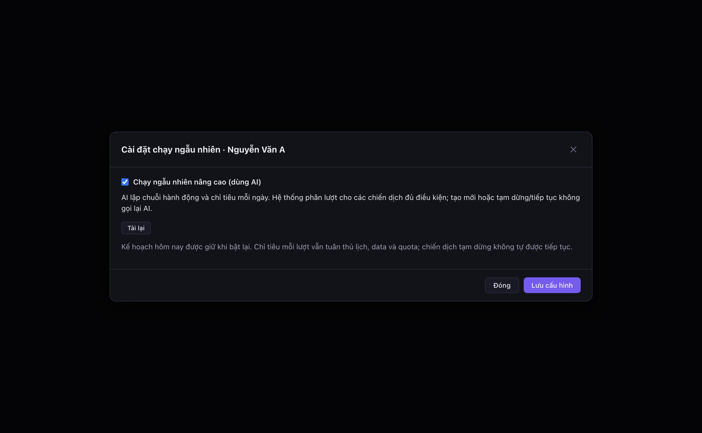
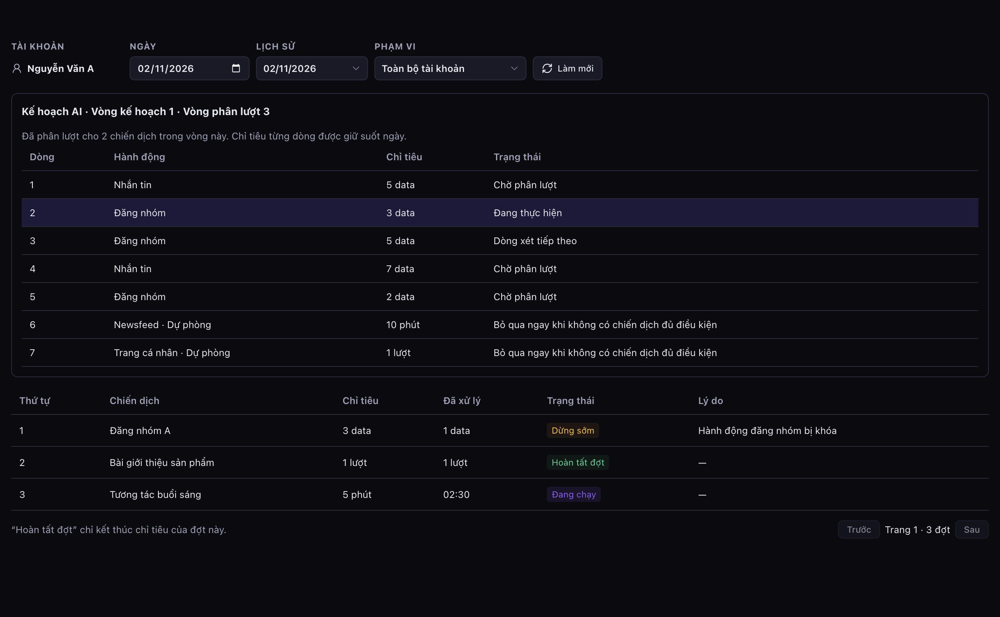

# Audit V444 — Facebook random AI (candidate trước đây V442)

## Trạng thái triển khai hiện hành — 02/11/2026

**Đã apply V444 lúc 22:27:21 Việt Nam**, project `akachat/cgjbsmqtfhqvttudyjzq`, ledger `20261102152721 / migration_v444_facebook_random_ai`. [Receipt triển khai](apply-receipt.json) ghi checksum, metadata trước/sau, trial `ROLLBACK`, hậu kiểm và quyền caller. Không apply lại khi merge.

Ledger đã có `migration_v442_campaign_agent_form` và V443 export Facebook group, nên đổi số candidate sang V444 trước apply. Chỉ đổi tên file/tham chiếu và nhãn guard; giữ body hàm, checksum nguồn/đích. SHA256 SQL đã apply: `4564db54b777551d1ee95723ed31d71b11bd5c987d34c94874883f9e77478bf9`. Receipt lịch sử V442 giữ nguyên; đường dẫn guide/audit giữ ổn định.

Đối chiếu lại 10 hàm nguồn cùng owner/ACL/security/volatility/config trước apply, không drift. Chạy toàn bộ candidate và postcheck trên production trong transaction kết thúc `ROLLBACK` đạt; sau đó apply kèm postcheck trước COMMIT và ghi ledger cùng transaction. Đọc lại sau commit: cả 11 hàm khớp, quyền Desktop/service_role và giới hạn anon/authenticated/Chat API giữ nguyên. Dùng linked Management API sẵn có; không thêm pool/SQL connection, worker hoặc polling. Không chủ động reload PostgREST hoặc tắt event trigger reload hiện có.

Sau đổi số: AI SQL 110 checks và ordinary SQL 6 ca parity + 2 ca turn phù hợp đều đạt local. Hai typecheck và build production giữ kết quả từ lượt sửa source gần nhất. `npm run dev` đã khởi động từ worktree; xác nhận bằng UI màn hình Chiến dịch tại `localhost:5173/`, dữ liệu đã tải. **Chưa đóng gói/phát hành, deploy proxy, kiểm hai Desktop thật hoặc canary AI/Facebook của tính năng.** Agent không tự bật AI/chạy chiến dịch để test.

## UI sau apply — ẩn Tải lại khi chọn AI

Theo yêu cầu người dùng, `FacebookRandomRunConfigModal` ẩn cả toolbar **Tải lại** khi checkbox AI đang tích; bỏ tích thì hiện lại. Chỉ thay điều kiện render, giữ nguyên draft, nút lưu và hành vi tải cấu hình thủ công. Không sửa hoặc apply DB thêm.

Hai typecheck node/web và bộ smoke UI Electron hiện có đều đạt. Đã xem ảnh fixture `/tmp/facebook-random-ai-hide-reload/ai-configuration.png`: checkbox AI tích, không còn nút Tải lại. Smoke vẫn kiểm tải lại thủ công, khôi phục draft và lưu AI. Không thêm test mới cho thay đổi hiển thị nhỏ này; không tạo bộ cài/phát hành.

## Kiểm chứng trước PR vào dev_3 — 02/11/2026

Fetch `origin/dev_3` xác nhận nền `37e68ef5` không lệch. Hai typecheck sạch; build production đạt (main 2,04 giây, preload 0,06 giây, renderer 23,25 giây). AI runtime 36 checks, SQL 110 checks, parity luồng chạy thường 6 ca và 2 ca turn phù hợp, giới hạn 8 ca, deadline/hủy 11 ca, manual runtime 30 checks, inventory/preflight, diagnostics và smoke UI Electron đều đạt. Dùng fixture local, không gọi provider/Facebook thật. Đã kiểm link tài liệu, JSON và whitespace diff.

Đọc lại 11 exact definitions live cùng metadata lúc `2026-11-02T16:23:03.422Z`: khớp đầy đủ receipt apply, không drift; SHA256 SQL đã apply giữ nguyên. Không apply lại hoặc thay quyền/runtime production trong lượt tạo PR. [Receipt kiểm chứng PR](pr-verification.json) ghi kết quả, kích thước build và giới hạn kiểm chứng. Chưa đo CPU trước/sau hoặc phát hành bộ cài.

Kiểm tra staged diff báo đúng một dòng trắng cuối file SQL sau `COMMIT`; giữ nguyên bytes migration đã apply để khớp SHA256 receipt. Các kiểm tra whitespace khác đều đạt; không thay cấu hình Git hoặc viết lại migration đã live chỉ để bỏ dòng trắng này.

## Lịch sử kiểm chứng source trước apply

Các mục dưới đây ghi trạng thái tại từng lần kiểm chứng trước triển khai; câu “chưa apply/không mutation production” trong các mục lịch sử không thay thế receipt triển khai bên trên.

Ngày kiểm chứng: 02/11/2026. Branch `codex/facebook-random-ai`; bản đầu kiểm chứng trên base `4c5081bf390fbc9a3c149387b495878a9c329e73`, bản sửa sau review trên base `c40be4b3` của `origin/dev_3`. Hợp đồng hiện hành: [feature V444](../../FACEBOOK_RANDOM_AI_V442.md).

## Phạm vi đã thực hiện

Source Desktop/main/preload/shared/renderer và candidate SQL. Production akachat chỉ được đọc metadata/định nghĩa cần thiết; **không apply migration, không thay prompt/model live, không deploy proxy, không đóng gói/upload/phát hành**. Không thao tác Facebook thật, không gọi provider AI thật. Không thêm pool/connection/worker/polling.

Đã chụp mười hàm random-run live cùng owner, ACL, security mode, volatility, config và MD5. Chỉ thay hai hàm; giữ patch ownership và lifecycle hiện hành. Hàm còn lại có guard checksum trong preflight. Dependencies chỉ để fixture/đối chiếu, không thay body live.

| Exact signature | MD5 nguồn live | MD5 đích |
| --- | --- | --- |
| `aka_agent_facebook_random_run(bigint,bigint,text,text,bigint,text,jsonb)` | `3c2caab8b949a640b4bdc3a61642ef31` | `4f9873daff8efc4d85e36b9c683d1e6f` |
| `private.facebook_random_ai_rules_valid(jsonb,jsonb)` | Mới; preflight yêu cầu chưa tồn tại | `795238d7689ad9efae3515cf156bdcb7` |
| `private.facebook_random_unit_started(bigint,bigint,uuid)` | `462463fb5676836150ff146a5f070d84` | `4e2a6f8bd7ddddb0b60448b281c6f04f` |

Nguồn/đích đầy đủ: [source.json](../../../migrations/snapshots/facebook-random-ai/source.json), [target.json](../../../migrations/snapshots/facebook-random-ai/target.json). Postcheck giữ nguyên owner postgres, security-definer/volatility/config của hai hàm có sẵn, timeout public 30s và ACL hiện hành (Desktop/service_role; không mở public RPC cho anon/authenticated/Chat API). Helper mới immutable/invoker, chỉ postgres có EXECUTE; parent definer gọi helper.

Thêm hai row cấu hình AI trong candidate: `app_facebook_random_run_plan`, model ID 21/code `openai_campaign_diagnostics_sol61`, timeout 120000ms. [Checksum seed](../../../migrations/snapshots/facebook-random-ai/seed-target.json) tính trên những cột được ghi, không phụ thuộc identity ID.

## Kiểm chứng

[Receipt bản đầu, trước sửa review](../../../migrations/snapshots/facebook-random-ai/verification.json): đối chiếu lại mười hàm live lúc 17:45:57 Việt Nam ngày 02/11/2026. Bảng dưới ghi kiểm chứng bản đầu; [receipt sửa sau review](../../../migrations/snapshots/facebook-random-ai/review-fix-verification.json) và [receipt rà soát tổng thể](../../../migrations/snapshots/facebook-random-ai/overall-review-verification.json) là lịch sử. Checksum đích hiện tại theo [receipt cách ly lượt chạy thường](ordinary-run-guard-verification.json) và bảng trên. Không có mutation production.

| Kiểm tra | Kết quả và phạm vi |
| --- | --- |
| Hai `npx tsc --noEmit -p tsconfig.node.json` / `tsconfig.web.json` | PASS |
| `npm run build` | PASS; bundle production main/preload/renderer, không tạo bộ cài |
| `facebook-random-ai-sql-smoke.cjs` | PASS: 60 checks; mười checksum nguồn trong PGlite trùng live; candidate đầy đủ BEGIN/ROLLBACK, apply local, postcheck, rollback bị chặn khi còn v2 và rollback thành công sau drain/đổi v1; hai hàm khôi phục đúng nguồn |
| SQL AI fairness/lifecycle | Chuỗi lặp, nhóm lệch số lượng, skip trước admission, paused/resume nối đuôi, giữ served, hành động dự phòng, loại mới chờ ngày sau, thu hồi catalog, qua ngày, giữ AI state khi chạy thủ công; admission hook thật, executor giả |
| SQL retry/quyền | Một lease thắng; request khác bị từ chối, commit idempotent, tắt/bật vô hiệu lease cũ, deadline 1m/5m và hết ba lượt, manual reset; Desktop own-scope thành công/cross-staff bị chặn; anon/authenticated/Chat API bị chặn |
| `facebook-random-ai-runtime-smoke.cjs` | PASS: 36 checks; summary 1201 chiến dịch và candidate reader 1202 qua bốn trang; quyền/schedule/paused/limits tổng hợp, không gửi body/recipient/credential; lost commit không gọi provider lại; single-flight, logout late response, scheduler không fallback hoặc spin |
| `run-facebook-random-run-ui-smoke.cjs` | PASS bằng Electron + Playwright: v1, repair/CAS, đổi AI giữ manual draft, không cần dòng thủ công, bảy dòng lặp đúng quantity, active row, reserve skip, refresh không retry, retry mutex, history/scope, stale responses, close/hidden cleanup, responsive |
| `facebook-random-run-runtime-smoke.cjs` | PASS: 30 checks; quota/unit budget, newsfeed minutes, blocked action, schedule, stop/finish log |
| `campaign-shared-schedule-smoke.cjs` | PASS: 30 RPC parity cases, 1440 policy cases, 18 TS/SQL parity, scheduler → SQL; fixture lịch sử |
| `facebook-random-run-boundaries-smoke.cjs` | PASS: reset/release/ownership/boundary regressions; fixture lịch sử |
| `facebook-random-run-stop-reason-smoke.cjs` | PASS: stop giữa lượt, stop+pause, đủ quota lượt, hết data |
| `facebook-random-run-lifecycle-smoke.cjs` | PASS: 48 checks recovery/claim/unit/lifecycle; fixture lịch sử |
| `campaign-diagnostics-smoke.cjs` | PASS; thêm AI mode với rules rỗng không bị báo thiếu cấu hình thủ công. Cập nhật stub auth/AI transport theo dependencies hiện hành của fixture |
| `desktop-ai-proxy-smoke.cjs` | PASS: 16 real-local-HTTP cases, fake provider; giữ payload/error/log, không đọc key từ Desktop, không tự retry/fallback |
| UI visual review | Đã xem ảnh config/plan; sửa highlight để đọc được trong dark theme. Ảnh lưu trong audit này |

Không đồng nhất fixture lịch sử với quyền production: riêng smoke V442 cài đúng các hàm/ACL đã capture và scope helper, dùng user/credential giả. PGlite tuần tự chứng minh điều kiện lease nguyên tử qua transaction/row lock; chưa chạy hai Desktop thật đồng thời. Chưa canary HTTP production hoặc kiểm Windows thật.

## Sửa sau review — 02/11/2026

Hai lỗi đã tái hiện và sửa:

1. Chiến dịch nội dung nâng cao rỗng vẫn qua preflight nhưng dừng trước unit, giữ đầu hàng đợi. AI preflight nay kiểm tra lỗi cấu hình này và thiếu nhóm nhận lời mời. Planner đưa turn đã kết thúc mà chưa admission xuống cuối hàng đợi đúng một lần, kể cả turn đã được release helper đóng. Không ghi `served`, không reset con trỏ/vòng, không thả ownership hoặc thử lại side effect chưa rõ kết quả.
2. Mỗi turn AI từng đọc toàn bộ input-data/action của mọi ứng viên. Inventory nay lấy projection cần thiết, phân trang 500 parent và hai left embed tối đa một ID đã lọc data bất kỳ/data đến giờ. Action và phép peek giới hạn trùng cấu hình được dùng chung trong đúng một inventory pass. Kiểm tra chiến dịch được chọn, claim và unit vẫn đọc mới.

Đã chụp lại `pg_get_functiondef` của mười RPC live, so khớp **toàn bộ definition, MD5, owner, ACL, security mode, volatility, config** với nguồn; không drift. Chỉ sửa tiếp body public RPC trong candidate chưa apply. Signature vẫn `aka_agent_facebook_random_run(bigint,bigint,text,text,bigint,text,jsonb)`, MD5 nguồn `3c2caab8b949a640b4bdc3a61642ef31`, đích mới `8f45af2dc0018c9ef8a87644dcd22a89`. Giữ guard quyền Desktop/staff và lifecycle hiện hành, timeout 30s, owner/ACL cũ; không mở caller hoặc thêm pool/connection/worker/polling. Postcheck và guarded rollback đối chiếu đích mới; preflight nguồn live không đổi. Target nếu apply vẫn là `akachat/cgjbsmqtfhqvttudyjzq`; **chưa apply**.

| Kiểm tra bản sửa | Kết quả |
| --- | --- |
| AI SQL | PASS 75 checks, gồm 15 kiểm tra bổ sung: planned skip, turn đã release trước admission, retry từ Desktop khác, giữ served/coverage/cursor/chỉ tiêu và nhường lượt. Trial ROLLBACK, postcheck, ACL và guarded rollback đều pass |
| AI runtime | PASS 36 checks; giữ phân trang trên 1.200 campaign, lost commit, logout, retry và không fallback |
| AI preflight | PASS query qua Supabase client thật với HTTP adapter local: parent scope, left embed/filter/limit đúng; data chờ sau 10.000 dòng hoàn tất; dữ liệu rỗng/tương lai/đã xóa; nội dung lỗi và sửa lại; toàn bộ không hợp lệ trả tick; quota khác cấu hình; quota/catalog thay sau plan vẫn chặn |
| Chi phí đọc preflight | 20 chiến dịch hợp lệ cùng action, 20 lượt: full input-data reads **420 → 20**, action reads **420 → 40**; inventory vẫn đọc mới mỗi lượt. Đây là số gọi adapter, không phải benchmark độ trễ production; số truy vấn quota còn phụ thuộc số cấu hình giới hạn khác nhau |
| Hồi quy | Manual runtime 30 checks; bốn ca stop reason; diagnostics; Zalo policy days-at-time đều pass, không có side effect ngoài fixture |
| Typecheck/build | Cả hai typecheck pass; `npm run build` pass (main 1,67s, preload 54ms, renderer 22,31s). Có cảnh báo chunk/import hiện hữu; không tạo bộ cài |

Không sửa UI trong lượt fix; kiểm UI bản đầu vẫn được ghi riêng phía trên. HTTP transport mới được kiểm bằng adapter local, **chưa canary Data API production**. Không dùng kết quả mock/PGlite để khẳng định hai Desktop thật hoặc hành động Facebook thật đã chạy.

## Rà soát tổng thể và sửa tiếp — 02/11/2026

Đã đối chiếu lại toàn bộ mười định nghĩa live và metadata với nguồn capture; không drift. Giữ source preflight, quyền/ownership/lifecycle và timeout hiện hành. Chỉ sửa nhánh đọc `day` trong public RPC candidate; checksum đích mới `4f9873daff8efc4d85e36b9c683d1e6f`. Postcheck/rollback đối chiếu đúng đích mới, không thay checksum nguồn để vượt guard. Phần trên là lịch sử bản sửa trước.

Ba lỗi đã có kiểm thử tái hiện trước sửa:

1. Lưu cấu hình đã thành công nhưng `loadAccounts` còn chờ; đóng/mở hộp mới rồi phản hồi cũ tới sẽ đóng nhầm hộp mới. Nay kiểm tra generation sau await cuối, giữ nháp vừa mở.
2. Tải thêm lịch sử rồi đổi ngày/phạm vi làm `loadingDates` không được xóa, nút **Ngày cũ hơn** bị vô hiệu mãi. Nay vòng đọc mới reset trạng thái chờ, phản hồi cũ vẫn bị loại.
3. Process bị ngắt lúc AI đang chạy, các chiến dịch sau đó đều tạm dừng: scheduler không gọi `ai_status`, nên tiến trình hiển thị generating vô hạn dù lease hết hạn. Nhánh `day` nay chiếu trạng thái theo DB clock, giữ lịch 1m/5m và số lần đã lưu, mở nút retry sau lần thứ ba. Không ghi state khi đọc; ngày cũ hiển thị kết thúc, UI không hướng dẫn bấm retry khi không khả dụng.

Kiểm thử SQL mở rộng chạy lượt AI qua public claim → nhận unit → settle → cleanup trong fixture: parent claim chưa ghi `served`, unit retry không nhân lượt, planner/finish không vượt ownership, giải phóng xong mới mở vòng tiếp. Fixture admission/lifecycle có dependencies lịch sử; không coi đây là canary production.

| Kiểm tra lần rà soát | Kết quả |
| --- | --- |
| AI SQL | PASS 110 checks; thêm 19 kiểm tra lease/history/read-only và 16 kiểm tra claim/unit/release. Candidate trial `ROLLBACK`, postcheck, ACL và guarded rollback pass |
| UI Electron + Playwright | PASS: tái hiện rồi sửa phản hồi save cũ, lịch sử đang tải khi đổi ngày; lỗi AI/ngày cũ không mời retry sai; giữ toàn bộ kiểm tra AI/manual, duplicate quantities, mutex, hidden/close, responsive |
| AI runtime / inventory | PASS 36 runtime checks; inventory trên 1.200 campaign, data chờ sau 10.000 dòng hoàn tất, lost commit/logout, late quota/catalog và giới hạn đọc giữ nguyên |
| Hồi quy | Manual runtime 30 checks; stop reason, boundaries, lifecycle, diagnostics pass trong fixture local |
| Typecheck/build | Hai typecheck và production build local pass; không tạo bộ cài |

Receipt, checksum migration, giới hạn kiểm chứng: [overall-review-verification.json](../../../migrations/snapshots/facebook-random-ai/overall-review-verification.json). **Không apply DB, không gọi provider AI/Facebook thật, không đóng gói/upload/phát hành**; chưa kiểm hai Desktop thật hoặc HTTP Data API production.

## Sửa deadline AI và giới hạn cấu hình cũ — 02/11/2026

Hai finding P2 của lần review tiếp đã sửa trong `facebookRandomAiService.ts`:

1. Tái sử dụng `withRequestDeadline` để giới hạn toàn bộ `callAiUsing` trong 120 giây, bao gồm đọc cấu hình và ghi log vốn không nhận signal. Khi hết hạn/hủy, service thoát chờ, ghi lỗi bằng RPC đã có và giải phóng controller; promise cũ vẫn có handler xử lý kết quả/lỗi muộn nhưng không được commit kế hoạch. Logout không ghi `ai_fail` sang phiên mới. Phạm vi deadline không bao gồm commit chưa rõ kết quả; giữ đối chiếu request ID/pending commit và retry 1m/5m trong DB.
2. Context nay xét cả action code trong danh mục và entry đã cấu hình, ưu tiên entry `byActionCode` nguyên khối như runtime. Không có entry thì dùng giới hạn cấp gốc của chiến dịch cũ; entry riêng rỗng/thiếu field không bị trộn với cấp gốc. Chỉ tổng hợp số hữu hạn không âm, giữ khoảng min/max và loại chiến dịch tạm dừng khỏi thống kê giới hạn chuỗi chính.

Không sửa AI runtime dùng chung, query/timeout SQL, migration, quyền, claim/unit/receipt hoặc UI. Đồng bộ fast-forward tới `37e68ef5` của `dev_3` và giữ nguyên các thay đổi feature chưa commit. Lượt fix này không đọc/ghi production; đối chiếu RPC live gần nhất thuộc lượt review trước, checksum migration/target giữ nguyên.

Kiểm chứng chuyên biệt: [facebook-random-ai-resilience-smoke.cjs](../../../scripts/facebook-random-ai-resilience-smoke.cjs) chạy service, AI runtime và deadline helper thật với đồng hồ/I/O giả. Có **8 ca đối chiếu giới hạn với scheduler** (cũ, riêng, một phần, rỗng/null, 0 và giá trị không hợp lệ), kiểm paused/min-max/không gửi nội dung; **11 ca timeout/hủy/phiên** tại đọc cấu hình, provider và ghi log. Đã kiểm controller được giải phóng khi I/O cũ chưa trả, lần sau thành công, response/rejection muộn không commit hoặc gây unhandled rejection, cấu hình cũ trả muộn không gọi provider mới. Đây là thời gian giả 120 giây, không phải một cuộc gọi provider thật kéo dài 120 giây.

Receipt và kết quả kiểm chứng: [deadline-limits-verification.json](deadline-limits-verification.json). Không apply DB, không đóng gói/upload/phát hành, không gọi AI/Facebook thật. UI giữ kiểm chứng của lượt trước vì lượt này không sửa UI.

## Cách ly lượt chạy thường — 02/11/2026

Rà soát riêng trường hợp không bật chạy ngẫu nhiên phát hiện helper `private.facebook_random_unit_started(bigint,bigint,uuid)` thêm `SELECT ... FOR UPDATE` lịch sử ngày ngay cả khi không có turn tương ứng. Đây là helper được gọi cho lượt Facebook thường. Khi tài khoản từng có lịch sử trong ngày rồi tắt ngẫu nhiên, JSON không đổi nhưng `xmax` chuyển từ `0` sang transaction ID, chứng minh phát sinh khóa dòng so với nguồn live.

Candidate nay `RETURN` ngay khi UPDATE turn cũ không tìm thấy turn đang chạy cùng claim. Giữ nguyên phần cập nhật unit metadata cũ, guard ownership, owner/ACL/security/config, thứ tự xử lý và timeout; không kiểm checkbox để tránh bỏ ghi nhận unit đã nhận khi đổi chế độ. Chỉ helper này đổi trong lượt fix, public RPC và prompt/model giữ nguyên. Source MD5 vẫn `462463fb5676836150ff146a5f070d84`; target trước sửa `1213d2bf20c62cd52226e32da4d80887`, target hiện tại `4e2a6f8bd7ddddb0b60448b281c6f04f`. Postcheck, rollback guard và target capture được cập nhật; các receipt cũ là lịch sử, không thay checksum nguồn.

Test [ordinary SQL smoke](../../../scripts/facebook-random-ai-ordinary-sql-smoke.cjs) đã fail trước sửa và pass sau sửa. Sáu ca đối chiếu nguồn/đích đi qua claim → unit admission/retry → settle → cleanup, gồm cấu hình null/v1/v2 AI đều đang tắt và có/không có lịch sử. So sánh state, thời gian cập nhật và MVCC tuple để phát hiện khóa thừa. Hai ca turn thủ công/AI có claim phù hợp vẫn ghi unit metadata, AI chỉ ghi `served` một lần kể cả checkbox đang tắt. Mọi ca nghiệp vụ kết thúc `ROLLBACK` trong PGlite; dependencies admission/lifecycle có định nghĩa lịch sử, không phải canary HTTP production hoặc thử hai Desktop thật.

Receipt kiểm chứng và đối chiếu lại mười RPC live: [ordinary-run-guard-verification.json](ordinary-run-guard-verification.json). Production chỉ đọc metadata; **không apply DB, không đóng gói/phát hành, không gọi AI/Facebook thật**.

## Tái lập

Từ repo đã cài dependencies:

```sh
AKA_AGENT_CHAT_API_REPO=/path/to/akaAgentChatApi node scripts/facebook-random-ai-sql-smoke.cjs
AKA_AGENT_CHAT_API_REPO=/path/to/akaAgentChatApi node scripts/facebook-random-ai-ordinary-sql-smoke.cjs
node scripts/facebook-random-ai-runtime-smoke.cjs
node scripts/facebook-random-ai-preflight-smoke.cjs
node scripts/facebook-random-ai-resilience-smoke.cjs
AKA_RANDOM_UI_OUTPUT_DIR=/tmp/facebook-random-ai-ui node scripts/run-facebook-random-run-ui-smoke.cjs
AKA_AGENT_WEB_REPO=/path/to/akaAgentWebApp node scripts/desktop-ai-proxy-smoke.cjs
npx tsc --noEmit -p tsconfig.node.json
npx tsc --noEmit -p tsconfig.web.json
npm run build
```

PGlite được lấy từ dependency hiện có của akaAgentChatApi, không thêm dependency app. Các script lifecycle/schedule lịch sử có thể ghi lại local-smoke.json; loại bỏ output phát sinh khỏi diff feature, giữ receipt gốc.

[Migration](../../../migrations/migration_v444_facebook_random_ai.sql) · [Postcheck](../../../migrations/tests/migration_v444_facebook_random_ai_postcheck.sql) · [Rollback guard](../../../migrations/tests/migration_v444_facebook_random_ai_rollback.sql).



